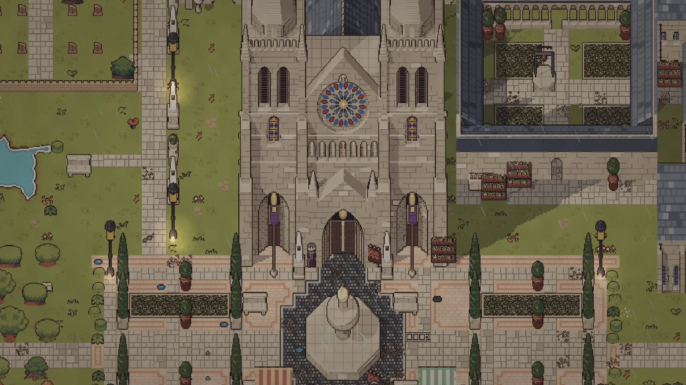
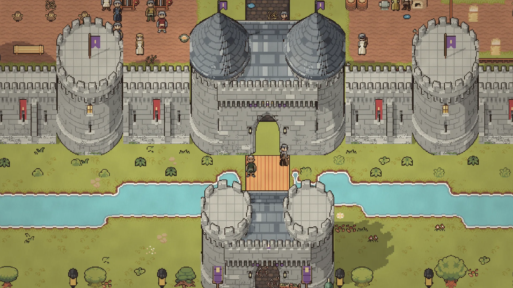
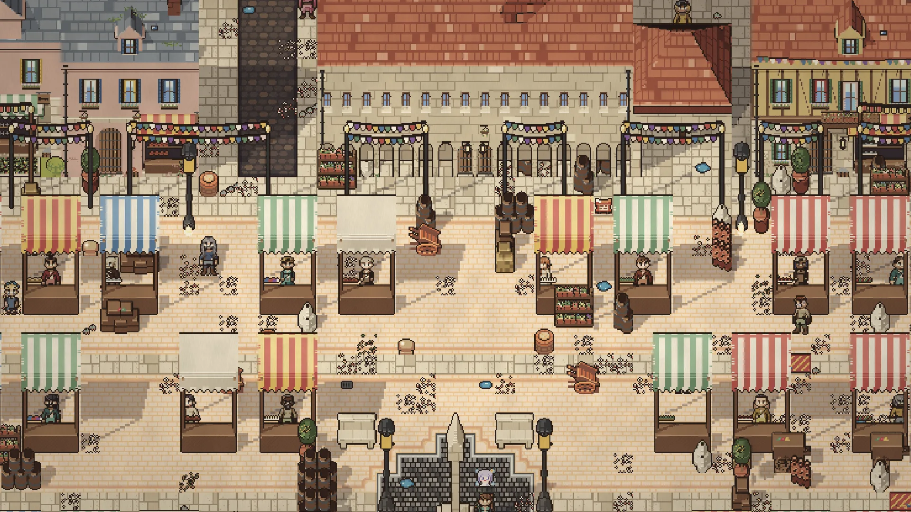
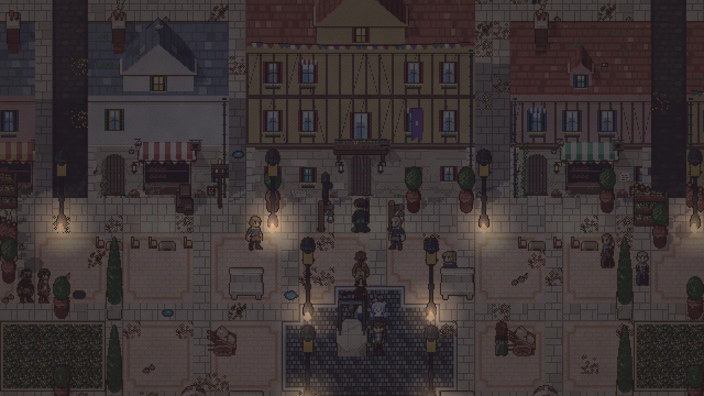
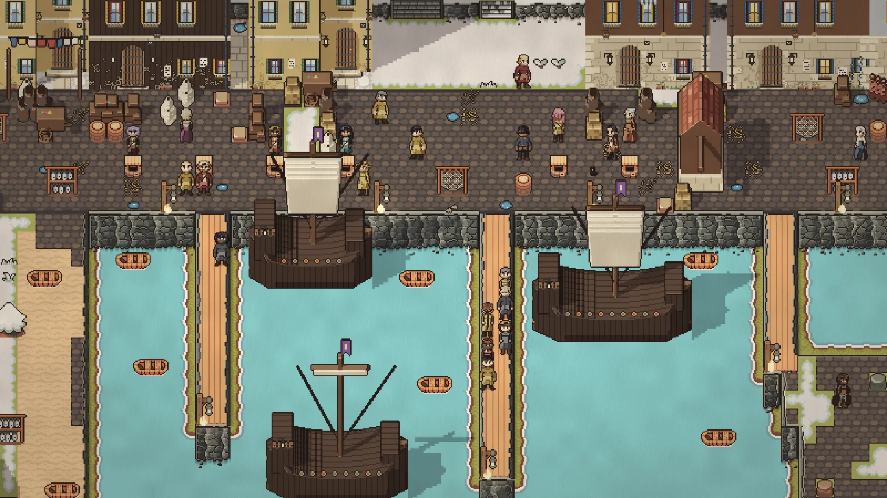
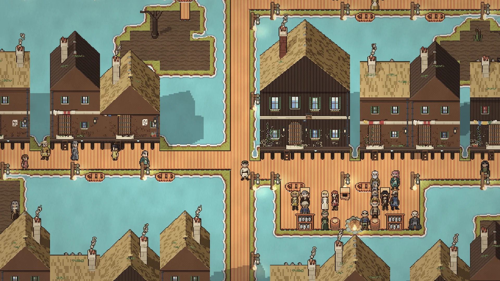
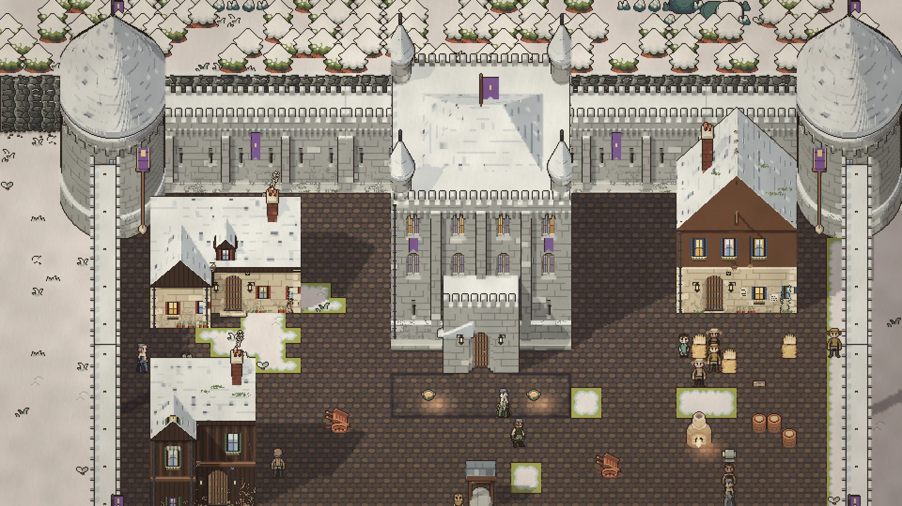
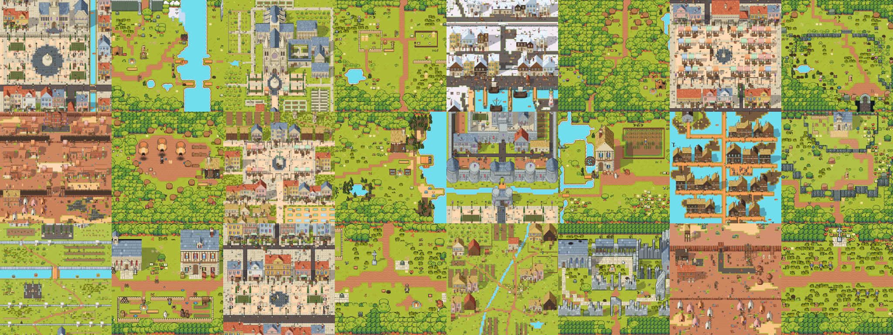

# OpenWorld

[](https://github.com/SihanXU/openworld/actions/workflows/check.yml)
[](https://github.com/SihanXU/openworld/actions/workflows/wiki.yml)



OpenWorld is a pixel-art open-world RPG that runs in the browser, together with the engine and editor it is built
on. Everything in the world follows rules written as data. When a player tries something no rule covers, a
language model can propose a new rule, which the engine validates before applying it. The game is fully playable
without a model.

<table>
  <tr>
    <td width="33%"></td>
    <td width="33%"></td>
    <td width="33%"></td>
  </tr>
  <tr>
    <td width="33%"></td>
    <td width="33%"></td>
    <td width="33%"></td>
  </tr>
</table>

OpenWorld is the research platform for the paper *Large Symbolic World* (in preparation).

## Contents

- [Features](#features)
- [How the AI fits in](#how-the-ai-fits-in)
- [Getting started](#getting-started)
- [Controls](#controls)
- [Engine and editor](#engine-and-editor)
- [AI setup](#ai-setup)
- [Repository layout](#repository-layout)
- [Development](#development)
- [Documentation](#documentation)
- [Contributing](#contributing)
- [Citation](#citation)
- [Credits and license](#credits-and-license)

## Features

**The game**

- A world of more than a thousand maps: villages, cities, wilderness and dungeons
- A main story with side quests and repeatable jobs
- Real-time combat, with boss fights whose attacks are telegraphed on the ground
- Crafting, farming, and building on your own land
- Characters with homes, jobs and daily routines, who trade and react to what they see
- English and Chinese

<table>
  <tr>
    <td align="center"></td>
    <td align="center"></td>
    <td align="center"></td>
    <td align="center"></td>
    <td align="center"></td>
    <td align="center"></td>
  </tr>
</table>

**The engine and editor**

- A deterministic TypeScript engine that runs in a Web Worker; a game's rules and content are data
- Optional modules for character classes, hunger, loot, characters' social behaviour and more
- An editor, in the browser or as a desktop app, for maps, characters, items, rules, story and quests, with
  playtesting and export
- Games packaged as standalone bundles that the same player runs



## How the AI fits in

Every interaction in the game is decided by rules attached to types of objects. When no rule defines what an
action does, the engine can ask a language model for one. The new rule may only fill that gap, never change
behaviour that is already defined, and it is tested in a sandbox before it is accepted. Accepted rules are shared,
so the next player who tries the same thing gets the same result. Without a model, such actions fall back to a
default, usually that nothing happens. Details: [docs/design.md](docs/design.md) §5.

## Getting started

Requirements: Node.js 24 and npm. A language model is optional.

```bash
npm install
npm run gen:world     # generate the world data
npm run dev           # the game at http://localhost:5173, the AI rule service on port 8787
```

`npm run dev` asks which model backend to use ([AI setup](#ai-setup)); `npm run dev:client` starts the game
alone. `npm run build` produces a static site in `games/openworld/client/dist`.

## Controls

| Input | Action |
| --- | --- |
| WASD / arrow keys | Move (hold Shift to walk) |
| Left click | Use the item in hand: swing a weapon or tool, or use it on yourself |
| Right click | Use the item in hand on what you point at, or place it there |
| E | Interact: pick up, talk, open, read |
| G | Put down, put into a container, give |
| Space / Q | Attack / dash |
| X / V | Draw or sheathe your weapon / sneak |
| 1–0, mouse wheel | Select a toolbar slot (Shift+Tab swaps in the next row of the bag) |
| Shift+1–6 | Skills |
| Tab or I, C, K, U, L, J, M | Bag, crafting, skill tree, skills, quests, codex, world map |
| B / R | Build mode / rotate |
| Esc | Menu |
| ` | Developer console (development builds only) |

All keys can be rebound in Options → Keys.

## Engine and editor

```bash
npm run play                          # the standalone player: http://localhost:5174/?game=/games/starter/
npm run editor                        # the editor: http://localhost:5175/editor/
npm run editor:build                  # build the editor as a standalone program, then: npm run editor:start
npm run desktop                       # the editor as a desktop app (npm run desktop:dist builds installers)
npm run game -- check games/starter   # validate a game project (build <project> --out <dir> makes a bundle)
```

The editor opens game projects from any folder. It edits maps, characters, items and other data, sprites and
sounds, rules, story and quests; fills gaps in the rules by hand or with a model; starts a playtest anywhere on a
map; and exports a game as a standalone web build. `games/starter` is a minimal example project.

## AI setup

The AI rule service is optional. Choose a backend with `npm run dev -- --backend <name>` or `LSW_MODEL_BACKEND`,
and put its settings in `.env` (not committed):

| Backend | Settings |
| --- | --- |
| `openrouter` | `LSW_MODEL_KEY`, `LSW_MODEL` (e.g. `moonshotai/kimi-k3`); `LSW_MODEL_URL` for another OpenAI-compatible endpoint |
| `anthropic` | `ANTHROPIC_API_KEY` |
| `claude-code` | None; uses the signed-in Claude Code CLI |
| `none` | None; only rules already learned are used |

```bash
npm run modder -- serve                    # run the service on its own, on port 8787
npm run modder -- serve 8787 --script packages/ai/fixtures/offline.json --data var/offline   # scripted, no model
```

In development the game connects to `http://localhost:8787`. Elsewhere, pass `?modder=<url>` or set
`VITE_MODDER_URL` at build time (`?modder=off` disables it). Players of a published build can instead enter their
own API key, which stays in their browser (Options → Your model; [docs/byok.md](docs/byok.md)). An overview of the
AI code is in [docs/ai.md](docs/ai.md).

## Repository layout

| Path | Contents |
| --- | --- |
| `packages/engine` | The engine core: world state, rules, effects, events, behaviour, quests, story, saves |
| `packages/modules` | Optional game systems: classes, waypoints, boons, hunger, social behaviour, loot, monster skills |
| `packages/stdlib` | Base types, statuses and rules shared by all games |
| `packages/format` | The game project format: validation, compilation, localization, JSON Schemas |
| `packages/runtime` | The player: rendering (Phaser 4), interface, audio |
| `packages/editor` | The editor: local server, web app, Electron shell |
| `packages/ai` | The AI rule service, model backends, and the research agent and benchmarks; the game builds without it |
| `games/openworld` | The game: content and rules, map generation and tools, the client, the wiki generator, assets |
| `games/starter` | A minimal example game |
| `docs/` | Design documents |
| `wiki/` | Wiki pages (Chinese, with an English edition) |
| `bench/` | Benchmark data for the research experiments |
| `site/` | The project website |

The engine packages never import a game, and games never import each other
(`packages/engine/test/boundaries.test.ts`).

## Development

```bash
npm run check         # typecheck and tests, as in CI
npm test
npm run typecheck
npm run coverage      # rule coverage report; commit the updated baseline with rule changes
npm run check:world   # headless playtest over two in-game days
npm run scale         # performance check across fifty maps
npm run test:ui       # browser tests of the interface (first run: npx playwright install chromium)
```

The interface components and their test page are described in [docs/ui.md](docs/ui.md).

**Wiki.** An encyclopedia of the game with a page for every item, character, creature, place and quest, partly
generated from the game data. It is written in Chinese, with an English edition. Live at
<http://35.239.4.44:5175/wiki/>; editing guide: `wiki/pages/帮助/编辑入门.md`.

```bash
npm run wiki          # http://localhost:5180/wiki/
npm run wiki:check    # check links and that every item and system has a page
npm run wiki:build
```

**Assets.** The subset of the [Ninja Adventure](https://pixel-boy.itch.io/ninja-adventure-asset-pack) pack the game
uses is committed in `games/openworld/public/assets/na/`. To update it, put the full pack in
`assets/ninja-adventure/` and run `npm run assets`.

## Documentation

| Area | Documents |
| --- | --- |
| Design | [design.md](docs/design.md) · [world-model.md](docs/world-model.md) · [game-design.md](docs/game-design.md) · [engine-split.md](docs/engine-split.md) · [roadmap.md](docs/roadmap.md) |
| World and story | [lore.md](docs/lore.md) · [release-1.md](docs/release-1.md) · [prologue.md](docs/prologue.md) · [chapter-1.md](docs/chapter-1.md) · [main-quest.md](docs/main-quest.md) · [continent.md](docs/continent.md) · [showcase.md](docs/showcase.md) · [firstlight-village.md](docs/firstlight-village.md) · [writing.md](docs/writing.md) |
| Game systems | [quests.md](docs/quests.md) · [npc-sandbox.md](docs/npc-sandbox.md) · [homestead.md](docs/homestead.md) · [construction.md](docs/construction.md) · [building.md](docs/building.md) · [gear.md](docs/gear.md) · [skills.md](docs/skills.md) · [skill-tree.md](docs/skill-tree.md) · [creatures.md](docs/creatures.md) · [bosses.md](docs/bosses.md) · [boss-rooms.md](docs/boss-rooms.md) · [music.md](docs/music.md) |
| Art and interface | [ui.md](docs/ui.md) · [looks.md](docs/looks.md) · [character-art.md](docs/character-art.md) · [cast/](docs/cast/) · [crop-art.md](docs/crop-art.md) · [alberic-art.md](docs/alberic-art.md) |
| AI and research | [ai.md](docs/ai.md) · [byok.md](docs/byok.md) · [rsi.md](docs/rsi.md) · [rsi-experiments.md](docs/rsi-experiments.md) · [paper-eval.md](docs/paper-eval.md) · [upstream.md](docs/upstream.md) · [fresh-pool.md](docs/fresh-pool.md) |

## Contributing

- Open a pull request against `main`. CI runs the typecheck and tests, and also builds the game without
  `packages/ai`.
- Add game behaviour as rules in `games/openworld/content`, not as engine code.
- Changes to the demo maps need a matching check in `games/openworld/tools/test/demo.test.ts`.
- New items, characters and systems need a wiki page (`npm run wiki:check` enforces this).
- Build new interface panels from the shared components ([docs/ui.md](docs/ui.md)).
- Write code, comments and documentation in English.

Architecture notes and project conventions: [CLAUDE.md](CLAUDE.md).

## Citation

If you use OpenWorld in your research, please cite:

```bibtex
@misc{openworld2026,
  title        = {OpenWorld: A Large Symbolic World},
  author       = {{OpenWorld Team}},
  year         = {2026},
  howpublished = {\url{https://sihanxu.me/openworld/}}
}
```

## Credits and license

- Code: [MIT](LICENSE).
- The project's own art (`games/openworld/public/assets/lsw/`): [CC0 1.0](games/openworld/public/assets/lsw/LICENSE.md).
- Art and audio from [Ninja Adventure](https://pixel-boy.itch.io/ninja-adventure-asset-pack) by Pixel-boy and AAA:
  CC0.
- Font: Fusion Pixel, under the SIL Open Font License 1.1 (`packages/runtime/src/fonts/`).
