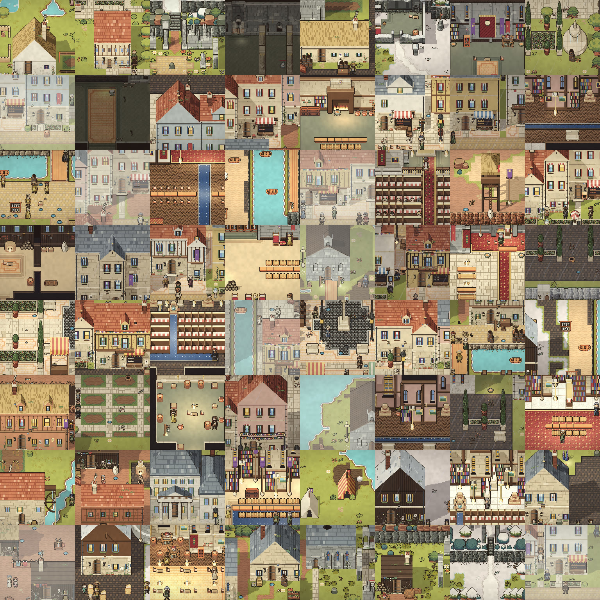

# OpenWorld

[](https://github.com/SihanXU/openworld/actions/workflows/check.yml)
[](https://github.com/SihanXU/openworld/actions/workflows/wiki.yml)


OpenWorld is a 2D JRPG that runs in the browser, together with the engine and the editor it is built with. The
world's state and rules are code. When the player does something no rule covers, a language model can write
the missing rule. The engine checks it, applies it to every thing of that type, and keeps it. Without a model
the game is complete and plays to its end.

<table>
  <tr>
    <td width="33%"><br><sub><b>The North Gate</b> · The Holy City</sub></td>
    <td width="33%"><br><sub><b>The Market</b> · The Holy City</sub></td>
    <td width="33%"><br><sub><b>The Lamp Ward</b> · The Holy City</sub></td>
  </tr>
  <tr>
    <td width="33%"><br><sub><b>Rimeholm</b> · Frostfang Coast</sub></td>
    <td width="33%"><br><sub><b>Dusk Moorings</b> · The Pale Fens</sub></td>
    <td width="33%"><br><sub><b>Frostbarrow Camp</b> · Frostfang Coast</sub></td>
  </tr>
</table>

<table>
  <tr>
    <td align="center"><br><sub><b>Lumi</b></sub></td>
    <td align="center"><br><sub><b>Sister Ilse</b></sub></td>
    <td align="center"><br><sub><b>Nessa Quill</b></sub></td>
    <td align="center"><br><sub><b>Lina</b></sub></td>
    <td align="center"><br><sub><b>Severin</b></sub></td>
    <td align="center"><br><sub><b>Tobin</b></sub></td>
  </tr>
</table>

The project is the testbed for the research paper *Large Symbolic World* (in preparation): a world defined
symbolically, as opposed to one learned by a neural world model, that grows as it is played.

## Contents

- [Overview](#overview)
- [Repository layout](#repository-layout)
- [Getting started](#getting-started)
- [Playing](#playing)
- [The engine, the player and the editor](#the-engine-the-player-and-the-editor)
- [AI (optional)](#ai-optional)
- [Development](#development)
- [Documentation](#documentation)
- [Contributing](#contributing)
- [Credits and license](#credits-and-license)

## Overview

**The game.** Release 1, *Part One*, runs from waking on Cloudtop, down the mountain, through Firstlight Village
and its country, across the Ford, and along the Pilgrim's Road to the White Knight. It has a main quest, errands
and radiant favours, a homestead, crafting and building, gear and a skill tree, monsters with their own skills,
and people who keep schedules and households, trade, and remember what they saw. Around it lies a continent of
1,024 maps and 1,651 people. The story and setting are in [docs/lore.md](docs/lore.md); the scope of the release
is in [docs/release-1.md](docs/release-1.md).



**The event model.** Every change to the world is the outcome of an event: an act, an impulse, a contact, a tick
of time. Rules belong to a host type. They read anything and write only their host, and reach other things by
sending them events. Where a rule tree ends in an undefined leaf (a *hole*), the outcome is the one place the AI
may answer. A patch only fills a hole and never changes behaviour that is already defined. It is validated
(host-only writes, replay in a sandbox) before it joins a shared rule library that every client syncs. With no
model, a failure or a time-out, the leaf's default applies. See [docs/design.md](docs/design.md) §5.

**The engine.** The engine is a pure, deterministic TypeScript kernel with optional modules. It runs in a Web
Worker and imports no game. A game is handed to it as data and code, and the same engine plays OpenWorld and the
minimal `games/starter`. The OpenWorld Editor makes games for it in the manner of RPG Maker. See
[docs/engine-split.md](docs/engine-split.md).

## Repository layout

| Path | Contents |
| --- | --- |
| `packages/engine` | The kernel: world state and indices, rules and their specificity, effect primitives, events, behaviour, quests, story, saves. No DOM, no AI. |
| `packages/modules` | Optional systems a game may name: classes, waypoints, boons, needs, society, loot, monster kits. |
| `packages/stdlib` | The standard library: the types, statuses and root rules the kernel names. |
| `packages/format` | The project format, its checker and compiler, localization, and the JSON Schemas. |
| `packages/runtime` | The player: rendering (Phaser 4), the DOM interface, audio, the engine's worker. |
| `packages/editor` | The OpenWorld Editor: a local server and page, and an Electron desktop shell. |
| `packages/ai` | The modder service, model backends, the self-improving agent and its benchmark harness. The game builds and plays without this package. |
| `games/openworld` | This game: content and rules (`content/`), maps and tools (`tools/`), the app (`client/`), the AI experiments (`ai/`), the wiki generator (`wiki/`), and its assets (`public/`). |
| `games/starter` | The smallest whole game, written as data files and played by the kernel with no module. |
| `docs/` | Design documents (see [Documentation](#documentation)). |
| `wiki/` | The wiki's pages, in Chinese with an English edition. |
| `bench/` | The benchmark pools for the research experiments. |
| `site/` | The project page. |

Dependencies point one way: a game may import the packages, never the reverse, and no game imports another
(`packages/engine/test/boundaries.test.ts` holds this).

## Getting started

Requirements: Node.js 24 (as in CI) and npm. A model is optional.

```bash
npm install
npm run gen:world     # generate the world → games/openworld/public/world/
npm run dev           # the game at http://localhost:5173, with the modder service on :8787
```

`npm run dev` asks which model backend to use (see [AI](#ai-optional)); `npm run dev:client` starts the game alone.
To build a static site:

```bash
npm run build         # → games/openworld/client/dist
```

## Playing

| Input | Action |
| --- | --- |
| WASD / arrow keys | Move (hold Shift to walk) |
| Left click | Use what you hold: swing a weapon or tool; with anything else, use it on yourself |
| Right click | Use what you hold on what you point at; set down a built thing there |
| E | The hand: pick up what lies loose; talk, open, read |
| G | Put down, put in, hand over |
| Space / Q | Attack ahead / dash |
| X / V | Draw or sheathe your weapon / sneak |
| 1–0, mouse wheel | Choose the toolbar slot; Shift+Tab brings the next bag row to the toolbar |
| Shift+1–6 | Skills |
| Tab or I, C, K, U, L, J, M | Bag, crafting, skill tree, skills, quests, codex, world map |
| B / R | Build mode / rotate what you build |
| Esc | Menu |
| ` | Mod Console (development builds) |

Every key can be rebound in Options → Keys.

## The engine, the player and the editor

```bash
npm run play                          # the engine's player: http://localhost:5174/?game=/games/starter/ (or /games/openworld/)
npm run editor                        # the OpenWorld Editor: http://localhost:5175/editor/
npm run editor:build                  # the editor as a standalone program → packages/editor/dist
npm run editor:start                  # run that build
npm run desktop                       # the editor as a desktop application (desktop:dist builds installers)
npm run game -- check games/starter   # a project's problems; `build <project> --out <dir>` writes a bundle
npm run bake                          # OpenWorld written as a project in the format → games/openworld/project/
```

The editor opens projects in any folder. It covers the game's settings, maps, people, database, pictures and
sounds, rules, story and quests, and the holes, which it can answer by hand or with the AI. It playtests from any
cell and exports a game anyone can play. See [docs/engine-split.md](docs/engine-split.md) §6 and §11–§19.

## AI (optional)

The game is complete without a model: a hole falls back to its default, and can be patched by hand in the Mod
Console. With a modder service running, holes are patched as they are met, and every accepted patch joins the
shared library. [docs/ai.md](docs/ai.md) is the map of this side of the repository.

Backends (`npm run dev -- --backend <name>`, or `LSW_MODEL_BACKEND`):

| Backend | Configuration (in `.env`, not committed) |
| --- | --- |
| `openrouter` | `LSW_MODEL_KEY`, `LSW_MODEL` (e.g. `moonshotai/kimi-k3`); optionally `LSW_MODEL_URL` for any OpenAI-compatible endpoint, and `LSW_MODEL_PROVIDERS` |
| `anthropic` | `ANTHROPIC_API_KEY` |
| `claude-code` | None: calls `claude -p` as the signed-in user |
| `none` | None: answers only from the shared library |

```bash
npm run modder -- serve                                   # the modder service on :8787
npm run modder -- serve 8787 --script packages/ai/fixtures/offline.json --data var/offline   # offline, scripted
```

The game finds a local service at `http://localhost:8787` in development. Elsewhere, set `?modder=<url>` or
`VITE_MODDER_URL` at build time; `?modder=off` turns it off. A published game can instead use the player's own
model and key, kept in their browser (Options → Your model; [docs/byok.md](docs/byok.md)). The service keeps its
data in `var/` (not committed). The self-improving modder and the research experiments are described in
[docs/rsi.md](docs/rsi.md), [docs/rsi-experiments.md](docs/rsi-experiments.md) and
[docs/paper-eval.md](docs/paper-eval.md).

## Development

```bash
npm run check         # typecheck + tests, as CI runs them
npm test              # vitest
npm run typecheck
npm run coverage      # interaction coverage; commit the refreshed baseline with rule changes
npm run check:world   # a headless playtest over two game days
npm run scale         # the world at scale: fifty maps, a tick, a frame, a save
npm run test:ui       # browser checks of the interface (Playwright; once: npx playwright install chromium)
```

The interface is built from shared pixel UI components, with a workshop page at `/ui-lab.html` in development:
see [docs/ui.md](docs/ui.md).

**Wiki.** The game's wiki is modelled on the Stardew Valley wiki: a page for every system, item, fixture, person,
creature, boss, place and quest, generated in part from the game's own data. It is written in Chinese, with an
English edition at `/wiki/en/`. The live site is <http://35.239.4.44:5175/wiki/>; how to edit:
`wiki/pages/帮助/编辑入门.md`.

```bash
npm run wiki          # http://localhost:5180/wiki/
npm run wiki:check    # links, templates, and completeness
npm run wiki:build    # → games/openworld/wiki/out
```

**Assets.** The full [Ninja Adventure](https://pixel-boy.itch.io/ninja-adventure-asset-pack) pack goes in
`assets/ninja-adventure/` (not committed); `npm run assets` copies the subset the game uses into
`games/openworld/public/assets/na/`, which is committed, so the game builds without the pack.

## Documentation

| Area | Documents |
| --- | --- |
| Design | [design.md](docs/design.md) (event model, inputs, AI interface) · [world-model.md](docs/world-model.md) · [game-design.md](docs/game-design.md) · [engine-split.md](docs/engine-split.md) · [roadmap.md](docs/roadmap.md) |
| World and story | [lore.md](docs/lore.md) · [release-1.md](docs/release-1.md) · [prologue.md](docs/prologue.md) · [chapter-1.md](docs/chapter-1.md) · [main-quest.md](docs/main-quest.md) · [continent.md](docs/continent.md) · [showcase.md](docs/showcase.md) · [firstlight-village.md](docs/firstlight-village.md) · [writing.md](docs/writing.md) |
| Game systems | [quests.md](docs/quests.md) · [npc-sandbox.md](docs/npc-sandbox.md) · [homestead.md](docs/homestead.md) · [construction.md](docs/construction.md) · [building.md](docs/building.md) · [gear.md](docs/gear.md) · [skills.md](docs/skills.md) · [skill-tree.md](docs/skill-tree.md) · [creatures.md](docs/creatures.md) · [bosses.md](docs/bosses.md) · [boss-rooms.md](docs/boss-rooms.md) · [music.md](docs/music.md) |
| Art and interface | [ui.md](docs/ui.md) · [looks.md](docs/looks.md) · [character-art.md](docs/character-art.md) · [cast/](docs/cast/) · [crop-art.md](docs/crop-art.md) · [alberic-art.md](docs/alberic-art.md) |
| AI and research | [ai.md](docs/ai.md) · [byok.md](docs/byok.md) · [rsi.md](docs/rsi.md) · [rsi-experiments.md](docs/rsi-experiments.md) · [paper-eval.md](docs/paper-eval.md) · [upstream.md](docs/upstream.md) · [fresh-pool.md](docs/fresh-pool.md) |

## Contributing

- Work on a branch and open a pull request to `main`. CI runs `npm run check`, and a typecheck, test and build of
  the game without `packages/ai`.
- New behaviour is a rule (data) in `games/openworld/content`, not engine code. A new primitive, condition or event
  kind is an engine change, and is added to the ModSpec documentation.
- Anything added to the demo's maps must witness a requirement in `games/openworld/tools/test/demo.test.ts`.
- Content that adds a thing or a system needs its wiki page (`npm run wiki:check` fails otherwise).
- New interface panels use the shared components in `packages/runtime/src/ui/components/` ([docs/ui.md](docs/ui.md)).
- Code, comments and documents are written in English.

[CLAUDE.md](CLAUDE.md) holds the full working agreements and architecture notes.

## Credits and license

- Code: [MIT](LICENSE).
- The project's own art (`games/openworld/public/assets/lsw/`): [CC0 1.0](games/openworld/public/assets/lsw/LICENSE.md).
- Art and audio from [Ninja Adventure](https://pixel-boy.itch.io/ninja-adventure-asset-pack) by Pixel-boy and AAA:
  CC0.
- Font: Fusion Pixel, under the SIL Open Font License 1.1, with its component fonts' licenses in
  `packages/runtime/src/fonts/`.
