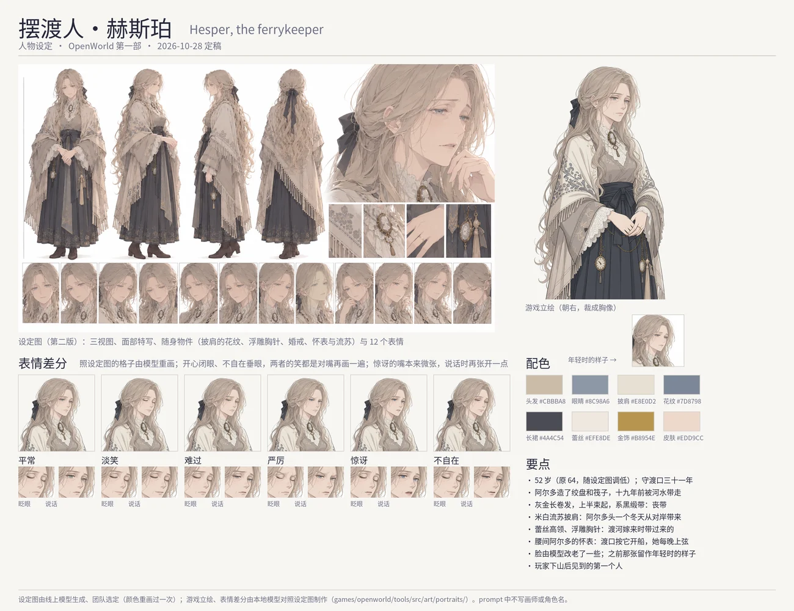

# Hesper (赫斯珀), the ferrykeeper: character sheet

Status: **built (2026-10-28)**: she has a portrait of her own (§2b), the seventh of the cast, the first person the player meets (after Lumi). The user's online
model drew her sheet, a melancholy widow, her hair blonde as the user asked: first in a dark sepia (`game_pic/new/忧郁贵妇角色设定集.png`),
then again in the cast's pale colours (`game_pic/new/c084c1b2-….png`, the sheet she is drawn from). This sheet and her canon were
brought together (§2): her look follows the sheet, and the story gives each piece of it a reason. What is in
the game is marked *(canon)* and cited. The art direction, the tools and the file formats are [../character-art.md](../character-art.md);
Nessa's turnaround is the style every sheet is drawn to ([nessa.md](nessa.md)).

## 1. Who she is

| | |
|---|---|
| Name | Hesper · 赫斯珀, the ferrykeeper of the Ford *(canon: `tools/src/demo/people/hesper.ts`, `npc.hesper`)* |
| Age | 52 (was 64; lowered 2026-10-28 to the sheet's face; she came to the crossing at twenty-one, and the river took Aldo when she was thirty-three) |
| Work | has kept the crossing thirty-one years; her husband Aldo built the winch and the raft, and the river took him the spring after; she stayed *(canon)* |
| Temperament | stubborn, plain, reserved, wary *(canon)* |
| In one line | a widow of few words who still keeps the river that took her husband, in the mourning she has worn nineteen springs |

### What the story gives her *(canon)*

- **The first person met.** Down the stair from the Mountain Foot, her arrival scene (`world.ts`, `arrival`) is the first
  word of Chapter 1: the storm took the ferry rope, but the footbridge a rider took, all in white, a crown of thorns grown
  through his helm, who pulled the planks out with his hands and laid the nails out on her pier "in a row, like a toll". She sends
  the player to Firstlight, where two are lost.
- **The ferry.** The rope is in her chest; mended on the winch, she takes the player over on the raft. With every way
  across gone, she poles them over herself ("the water is going down").
- **The night of the theft** (`ford_night`): she saw a man in grey walk across her river, the water freezing under each step.
  "Thirty-one years I have kept this water. I have never seen it hold a man up."
- **The Pilgrim's Road** (`hesper_stumps`): the thorns driven into the stumps; "Aldo and Joss built that bridge… Every
  board I walked on, he cut. Mend it. Then go and tell that knight whose bridge it was."
- **After the knight** (Part Two): "Then I'll build the bridge again. Properly, this time."
- Her hands have stiffened and she will not say so; Tobin owes her last autumn's fare and she never asks for it (`ties`).
  Every way east in Part One goes over her river, to the knight and back with the Crown ([../release-1.md](../release-1.md)).

## 2. Her design

The first proposal (the same day: hair in a bun under a russet kerchief, an indigo oilcloth coat, a ferry pole) gave way to
the sheet the user chose. The sheet draws a widow rather than a boatwoman; the two were brought together both ways:

| The sheet | Its reason in her story |
|---|---|
| long, wavy hair to her thighs, half tied back with a **black ribbon** | the mourning ribbon: she has tied it every morning since the river took Aldo, nineteen springs ago (proposed) |
| a **gold pocket watch** and a tassel on chains at her sash | Aldo's watch: the crossing ran by it and still does; she winds it every evening, and by it she knows the evenings come sooner every week *(canon line)* (proposed) |
| a plain **gold ring** | her wedding ring |
| a large cream **fringed wool shawl**, grey-blue floral embroidery | Aldo brought it over the river the first winter, as he brought her the things she liked from the far bank *(canon: her `favourite` line)* (proposed) |
| the **white lace collar and cuffs**, the **cameo** at her throat | what she brought with her when she crossed the river to marry the ferryman, thirty-one years ago, and still wears (proposed) |
| the dark slate dress with a wide sash and an embroidered hem, heeled boots | a widow's dark dress |
| the melancholy face, faint lines at the eyes | her reserve; her age lowered to the face, 64 → 52 |

And the picture moved to the game: the first sheet's dark sepia sat muddy beside the cast, so the user had it drawn again in
pale, clean colours; her sprite is drawn from that sheet alone, in its own style.

- **Hair** blonde (the user, 2026-10-28; her record has steel grey): a light ash-blonde, long and wavy to the thighs, the upper
  part braided back and tied with a dark ribbon, a few strands loose about her face.
- **Face** grey-blue eyes *(canon: `storm`)*, a quiet, melancholy look; faint lines at the eyes.
- **Clothes** the cream fringed shawl with grey-blue flowers over the shoulders; a dark slate dress with a wide sash and an
  embroidered hem; cream lace high collar and cuffs; the oval cameo at the throat with a small tassel; the pocket watch and a tassel
  on chains at the sash; a gold ring; short heeled brown boots.
- **Her things** (the story's, not on the sheet) the ferry pole, the storm lantern she lights earlier every week, the eight
  nails the rider laid on her pier *(canon; the ninth is Joss's errand)*.
- **In the game** her own portrait faces right, mid-thigh up, her hands folded at her waist; her map sprite follows *(canon)*:
  `hair.wavy` ash, no headscarf, `outfit.shawl` charcoal and linen, `storm` eyes, `fair` skin.

Palette (from her portrait): hair `#CBBBA8`, eyes `#8C98A6`, shawl `#E8E0D2`, embroidery `#7D8798`, dress `#4A4C54`, lace `#EFE8DE`,
gold `#B8954E`, skin `#EDD9CC`.

## 2b. Her own portrait (2026-10-28, built)

- **The sprite** seed 4 of eight drawn by Qwen-Image-Edit from the revised sheet alone, in its own style (with Nessa's turnaround as
  picture 2 the lines came finer but the face less hers), cut at mid-thigh, her hands folded at her waist. The user found her young:
  her face alone was made older by the model (the face's crop at 3x, a soft ellipse, "a few years older, about fifty, very subtly",
  denoise 0.7, seed 2), the strongest of four the user saw; at full strength the mildest words had aged her fifteen years. The
  picture before is kept as her younger self (`game_pic/hesper/young.png`), a photograph for a later scene.
- **The moods** after the sheet's faces (`moodRefs`, cells counted from the left): happy her eyes closed (cell 4), sad (6), surprised
  (7), shy her eyes lowered (10); angry from words alone, the sheet having no hard face. The smiles of happy and shy are a second
  pass over the mouth (`moodTouch`): the first kept the sheet's faint mouths, barely a smile. Sad, angry and surprised redraw the
  brows too (`brows`, `moodKeepAlso`).
- **The frames** happy keeps its closed eyes (no blink) and talks along its smile; the surprised face, already parted, opens a
  little more to talk (asked to open wide, it shouted).
- **In the box** framed like the others: the whole head in the box, her face a little right of the middle, toward the text.
- Config `tools/src/art/portraits/hesper.json`; the set in `public/assets/lsw/Portraits/hesper/`, the catalogue's
  `portraits['npc.hesper']`. Her lines carry the moods: Aldo's (`default`, the stumps scene) sad, "Eat it yourself…" shy, the grey
  man on the ice surprised.

## 3. Her moods

Her lines are short and her face moves little. The sheet's twelve faces are all quiet and sorrowful; four moods take a cell,
one is drawn from words:

| Mood | Her face | From | Her lines that use it |
|---|---|---|---|
| neutral | quiet and melancholy, the lips closed | the sprite | most |
| happy | a faint smile, the eyes closed | cell 4 | `given:favourite` (Aldo used to bring it), `topic:winch_mended` |
| sad | sorrow, the eyes lowered, the brows raised within | cell 6 | Aldo's lines (`default`, `hesper_stumps`) |
| angry | stern, the brows drawn down, the mouth a hard line | words | `topic:theft` ("I saw that. Put it back.") |
| surprised | restrained, the eyes a little wider, the lips parted | cell 7 | the grey man on the ice (`ford_night`) |
| shy | the eyes lowered, a small smile | cell 10 | `given:item/food` ("Eat it yourself. … Fine. Thank you.") |

## 4. Her lines

Unchanged (main's polish of 2026-10-26 kept): they already have her voice. Proposed, not yet written:

- A bookend: the first person met sees the player off. When the pilgrim first crosses to the far bank with the pilgrimage
  called, on the way to the knight, Hesper at the landing: "Thirty-one years, and I still stand here to watch them go." /
  「三十一年了，我还是会站在这儿看人走。」 and "The river will be here when you come back. So will I." / 「河会在这儿等你回来。
  我也是。」 (First proposed for the ending at the Ford; release 1 now ends with the Crown home, 2026-10-26.)
- Two that show the sheet's pieces: "Nineteen springs I have tied this ribbon. The hands forget a rope; they do not forget
  that." / 「这条缎带我系了十九个春天。手会忘了怎么接绳子，这个倒忘不了。」 and "Aldo brought this shawl over the river the
  first winter. It has lasted longer than he did." / 「这条披肩是阿尔多头一个冬天从河对岸带回来的。它比他长久。」

## 5. The brief

The sheet came from the user's own prompt; the brief page (the first proposal's prompts) stays as a record. An expression
sheet after this sheet (picture 2) would give the stern face a reference, if the drawn one misses.
