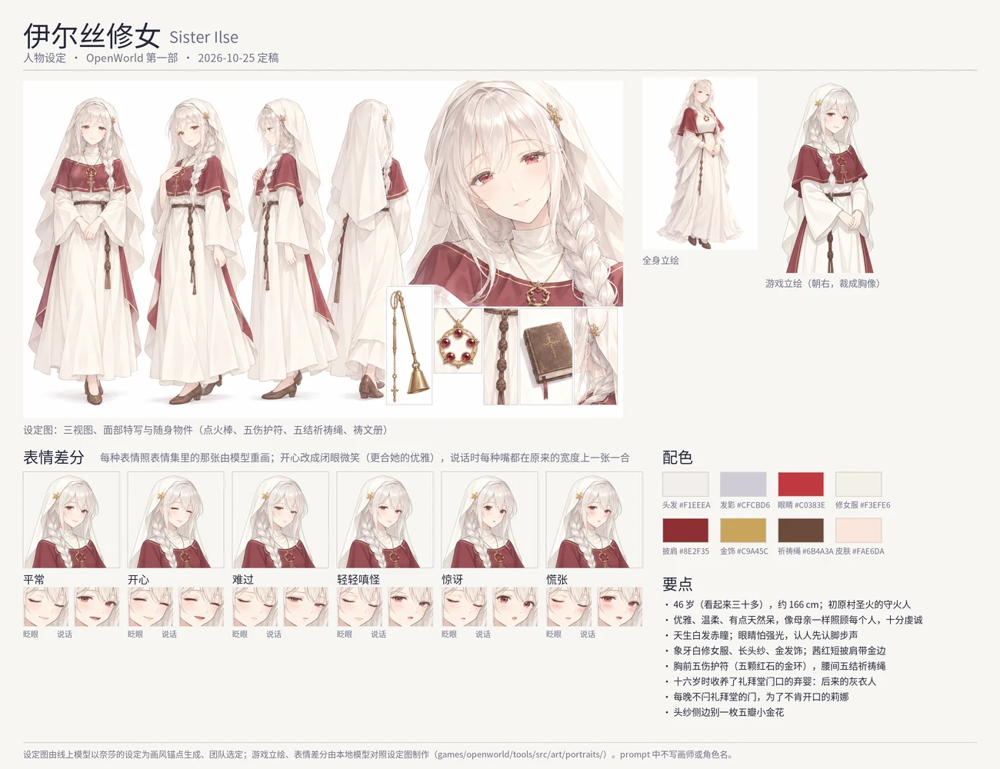

# Sister Ilse (伊尔丝修女): character sheet

Status: **built (2026-10-25)**: her record, lines and look follow this sheet, and she has a portrait of her own. The sheet came from
the online model (`game_pic/new/银发修女角色设定图.png`, a full-length figure `game_pic/new/f1137b65….png`, the expression sheet
`game_pic/new/5d9051df….png`). What was in the game before is marked *(canon)* and cited. The art direction, the tools and the file
formats are [../character-art.md](../character-art.md); Nessa's turnaround is the style every sheet is drawn to ([nessa.md](nessa.md),
[lumi.md](lumi.md), [lina.md](lina.md)).

## 1. Who she is

| | |
|---|---|
| Name | Sister Ilse · 伊尔丝修女 *(canon: `tools/src/demo/people/ilse.ts`, `npc.ilse`)* |
| Age | 46 (lowered from 56 on 2026-10-25, with Severin's 40 → 30; chapter-1.md §5, §7) |
| Work | keeper of Firstlight's flame and its chapel at Astra's altar *(canon)*; she sends the player on the pilgrimage *(canon)* |
| Temperament | gentle, polite, outgoing, hopeful (was serene, polite, reserved, hopeful); the tag `devout` kept |
| In one line | a graceful, gentle nun of deep faith, a little absent-minded, motherly in every small care — she forgets where she put her taper and never once a word of the litany, and she knows the step of the boy she raised |

The team's reference for her is a nun of another visual novel (gentle, a little airheaded, motherly, deeply devout; white hair and
red eyes) — for us only; no prompt names her, a work or an artist. The ink on her cuffs (chapter-1.md §7) is dropped.

### Her past (proposed)

- **Born white-haired and red-eyed.** The village called her the dawn's child. Her eyes are weak in bright light: she reads by the
  flame, squints at noon, and knows everyone in Firstlight by their step before she sees their face. (It is how she knew the grey
  man's walk in the dark chapel, *canon: "she recognised his walk in the chapel and told no one"*.)
- **Given to the chapel's service as a girl**, she wanted nothing else; a novice by fifteen *(canon: Brother Cassian "sat in this
  chapel when I was a novice", thirty-one years ago)*.
- **At sixteen** someone left a baby on the chapel step, by the flame. "The flame did not turn him away, so neither will I." The old
  keeper let her raise him. At ten a brother of the Ashen Watch, come to tend the flame, took him into the order *(the boy at the
  bridge-payer's heel in Joss's line)*. He is Severin, the grey man.
- She became the keeper when the old keeper died. Brother Anselm serves in her chapel *(canon)*; Rowan is an old friend *(canon)*.

### Lina and her (proposed, 2026-10-25)

- When Lina's mother died of a winter fever (Lina eight, [lina.md](lina.md)), Ilse sat with her through the last nights and held
  Lina at the burial. She offered to take her into the chapel's care, as she once took in the foundling; Lina would not be given to
  the chapel or owe anyone. Ilse did not press: since then she leaves the chapel door unlatched every night. On the coldest nights
  Lina slips in to sleep by the flame and wakes under a blanket, bread by the altar; neither speaks of it.
- When the Church named Lina's father a pilgrim, it was Ilse who blessed him at the flame. Lina hates the Church and not her:
  "She's not the Church. She's just the sister."
- Lina is grateful and fond of her and never says so: the best dawnbloom on the altar before dawn ("it was extra"), no one mocks
  the sister's forgetfulness near her, and the grave-robbing is the thing she most hides from her. She once asked, as if idly,
  whether a prayer counts for someone no one visits (the ring's owner); Ilse said every prayer counts and did not ask for whom.

### She cares for everyone (proposed)

The player soaked in the rain, the doors she counts closing on a storm night, Oskar's knees before rain (a warm stone at his
door; he thinks it was Marta), Nessa's candles, Pell's drawings of the road east his father took; and every pilgrim she blessed she
remembers by their step: "Come back, so that I may hear yours again."

### What she does not say *(canon, chapter-1.md §7)*

- She raised Severin; she knew his step the night the flame was taken, and told no one.
- She once read a book of the Ashen Watch that the Church burned.
- After the Crown: "He always did carry things that were too heavy for him." *(canon, her line at the end of Chapter 1)*

### How she is with people

Graceful and gentle, her kindness in what she does and how she cares for people rather than in pet names: she asks a traveller with
cold hands to come nearer the flame, leaves bread by the altar, keeps a seat by the fire, leaves the chapel door unlatched for Lina,
who pretends to need no one; the children she calls "children" (the user: "little one" is not graceful). Absent-minded in small
things, never losing her poise: she forgets what she came out for, loses wicks, greets the wrong person in the sun, and smiles at it.
Her faith is warm and whole, never stern: she gives thanks every dawn for the night being over.

## 2. Her design

- **Hair** white, with a faint warm and lavender-grey shading; long and soft, the fringe and a loose braid over her left shoulder
  showing under the veil.
- **Eyes** crimson; soft, gently drooping outer corners; long pale lashes; a kind, slightly dreamy look. A soft smile.
- **The sheet's crosses** (on the cape, the shoes, the book) read as the holy wood Astra was nailed to (the tale: "He was nailed to the
  holy wood").
- **Age in the drawing** a mature woman who looks younger than her years, in her thirties: gentle maturity, not a girl.
- **Clothes** (as the sheet drew them) an ivory nun's habit, long and high-collared, with wide sleeves; a deep madder-red shoulder cape
  with a thin gold border and a small cross; a long, soft ivory veil to below the waist, pinned at its side with a small gold five-petal flower (the sheet's loose cross-shaped ornament, its shape made
  regular, 2026-10-25); at her throat on a fine gold chain the Amulet of
  the Five Wounds *(canon: an item, her quest's reward)*: a small gold ring set with five red stones; at her belt a prayer cord of
  five knots; soft brown shoes.
- **Her things** a long brass taper with a snuffer's bell, for tending the flame; a small worn litany book.
- **Build** about 166 cm, soft, a motherly figure; the habit modest.
- **In the game** her own portrait faces right like every own portrait, her hands folded at her waist round the prayer cord, the
  head a little tilted; her map sprite: white hair (`snow`), red eyes (`ember`), `outfit.vestment` ivory and madder, the hood.

Palette (proposed): hair `#F1EEEA` with shading `#CFCBD6`, eyes `#C0383E`, habit `#F3EFE6`, scapular `#8E2F35`, gold `#C9A45C`,
veil shadow `#DCD6CB`, prayer cord `#6B4A3A`, skin `#FAE6DA`.

## 3. Her lines (built)

Her voice: graceful, soft, unhurried, in a composed register; her care in small things (cold hands, a meal, a door left unlatched, a
seat kept by the fire); small lapses of attention that never cost her poise; the litany said whole, as a true thing. The second draft
(2026-10-25) took out what read as folksy ("little one", "oh my", "sit, sit"). Built in
`tools/src/demo/people/ilse.ts` (temperament gentle, polite, outgoing, hopeful; look `hair.braid` white, `face.soft` red eyes,
`outfit.vestment` ivory and madder, the hood): small talk minding people (bread by the altar, Anselm reading aloud, the door left
unlatched for Lina, Oskar's warm stone, Nessa's candle, Pell's drawings, the dawnbloom on the altar), lines for morning, evening,
night, rain and storm, the rescue, the flame taken ("My hands are slower than my heart to believe the flame is gone"; "The way you
stand reminds me of someone I knew", once), the letter ("I remember every pilgrim I have blessed by their footsteps"), the crown's
lullaby and a gift; three scene lines in `tools/src/demo/quest/chapter1.ts` (the arrival, the tale's end, the letter: "Astra never
errs, pilgrim, even if I often do") and the Vigil's hand-in in `content/src/quests/main.ts` ("this time, I didn't lose a single
wick"). The tale of the First Night, the litany, "Some people take a thing to keep it", Cassian's and the chapter's end are kept.
Lina has six lines about her (`lina.ts`).

## 3b. Her own portrait (2026-10-25, built)

- **The sprite** seed 1 of six drawn by Qwen-Image-Edit from her sheet, her hands folded at her waist; drawn facing left and turned
  by the cut (`mirror`). The white veil and hair on white cut cleanly (isnet-anime with alpha matting).
- **The moods** after the user's expression sheet (`game_pic/new/5d9051df….png`, twelve faces: `moodRefs` its cells). Happy, sad and
  shy redraw only the eyes and the mouth (`features`, a hard edge), her faint brows kept: the sheet's brows there are the neutral's.
  Angry and surprised move the brows as the sheet does (knitted and pressed toward the nose; raised high, the eyes rounder), so their
  regions take the brows too (`brows`, `moodFeatures`) and their words say one thin brow over each eye, the old lines gone
  (`moodKeepAlso`); the first round kept the neutral's brows everywhere and the user found angry and surprised unlike the sheet.
  Surprised's mouth, drawn far wider than the sheet's, was made a small round 'o' by a second pass (`moodTouch`). Seeds tried and
  chosen (`moodSeeds`: happy 11, angry 4, surprised 1).
- **Happy** a graceful closed-mouth smile, the eyes shut in crescents (the user: the sheet's open laugh does not fit her grace): seed 11
  of fourteen, and a second pass over both eyes clearing the open eyes' traces above the lashes and the highlights' glints.
- **The frames** every talk opens the mood's own mouth across its own width, so it opens and closes (the user: a wide smile turning
  into a small oval reads as one big, one small); sad, cross, shy and surprised drawn with the sheet's speaking face (cell 12) as
  picture 2 (`moodFrames` `ref`), the smiles without it (with it they opened far too wide). Happy has no blink; the other blinks are
  the neutral's shut eyes (the model's own sad blink left the iris showing), the moved brows kept above them.
- **The ornament** the sprite drew the veil's ornament as an irregular lump. Its shape was mended in place (a five-petal flower, the
  top petal longer, its warm gold and the angle it lies at kept); then, the top petal still leaning left, the flower was designed in the
  plane the other four petals fix (an affine fit), every petal lit from one side, and the model drew it on the clean veil from that design,
  a light pass bringing its colour back to the accepted one (`ornamentNote`). The same pixels laid into every frame. Two ways that looked
  pasted on, and were left: a new ornament drawn from a clean frontal design, and one petal rotated five times (its light turned with it).
- Config `tools/src/art/portraits/ilse.json`; the set in `public/assets/lsw/Portraits/ilse/`, the catalogue's `portraits['npc.ilse']`.

## 4. The brief (for the online model)

The style anchor is Nessa's turnaround, uploaded as picture 1 (the anchor's words are in [lumi.md](lumi.md) §5). The sheet, the
expression sheet and the sprite as for Lumi and Lina; the sprite knees up, three-quarter, facing the right of the picture, her hands
folded at her waist round the prayer cord. Her expression sheet: a gentle smile, beaming, sad, a gentle scolding pout, "oh my",
flustered, praying, puzzled, worried, drowsy, a blink and a word. The full prompts are on the brief page.
