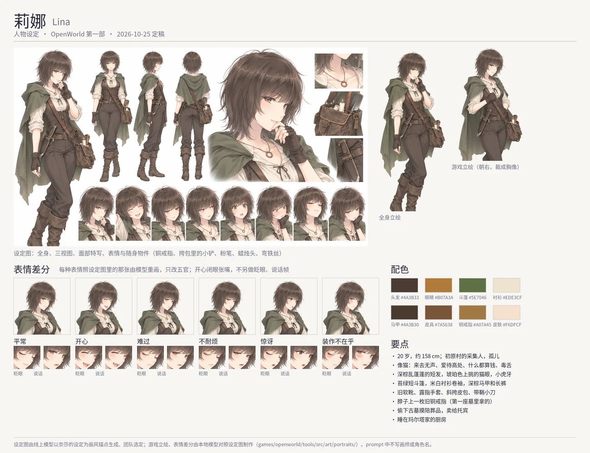

# Lina (莉娜): character sheet

Status: **built (2026-10-25)**: her record, lines and look follow this sheet, and she has a portrait of her own. What was in the
game before is marked *(canon)* and cited. The art direction, the tools and the file formats are [../character-art.md](../character-art.md); Nessa's turnaround is the
style every sheet is drawn to ([nessa.md](nessa.md), [lumi.md](lumi.md)).

## 1. Who she is

| | |
|---|---|
| Name | Lina · 莉娜 *(canon: `tools/src/demo/people/lina.ts`, `npc.lina`)* |
| Age | 20 (was 24) |
| Work | a forager of Firstlight *(canon)*; in truth she also robs the old barrows south of the grassland, and sells what she finds to Tobin the peddler, who never asks |
| Where | sleeps on a bed in Marta's cookhouse *(canon: her schedule, `meadow.cook:bed.3`)*: no house took her in; tends herbs in the village by day *(canon)* |
| Temperament | sly, plain, reserved, wary (was brave, polite, outgoing, hopeful) |
| In one line | a cat of a girl who trusts no one and pays her own way — and who leaves the best mushrooms on a lonely boy's doorstep and swears it was the wind |

The team's reference for her is a character of another visual novel (short curly hair, a sly smile, a cat's ways, a sharp tongue
over a caring heart) — for us only; no prompt names her, a work or an artist.

### Her family

- Her father was one of the pilgrims the Church sends east *(canon: pilgrims have been sent since the 212th year, chapter-1.md)*; he
  never came back. Pell's father also went east and did not write *(canon: Marta's line)* — she sees herself in Pell.
- Her mother died of a winter fever when Lina was eight. The village fed her by turns, Marta most of all, but no house took her in;
  she has slept in Marta's cookhouse since.
- Oskar, the oldest forager *(canon)*, taught her the mushrooms and the paths when she was small. He grumbles at her; on the storm
  night he was the one who followed her into the barrow to drag her out *(canon: "He followed Lina into the barrow to bring her out")*.

### Sister Ilse (proposed, 2026-10-25)

Ilse sat with her mother through the last nights and offered to take her into the chapel's care; Lina, eight, refused. Since then
the chapel door is never latched; on the coldest nights Lina sleeps by the flame and wakes under a blanket. Ilse blessed her father
when the Church named him pilgrim; Lina hates the Church, not her. Grateful and fond of her, she never says so: dawnbloom on the
altar before dawn, no one mocks the sister's forgetfulness near her, and the grave-robbing is what she most hides from her
([ilse.md](ilse.md)).

### What she does not say

- The village believes she and Oskar sheltered from the storm in the Old Barrow *(canon: the quest's words, Rowan's)*. In truth she
  went down on the storm night, when no one would see, for the warden's grave goods; Oskar followed her.
- The grave goods go to Tobin. **The old almanac from before the First Night that Tobin sold Nessa** *(canon: Nessa's line)* came out
  of a barrow, by Lina's hands. Nessa does not know; Lina does, and says nothing.
- The grey man shut the restless warden in and left them bread marked with ash *(canon: chapter-1.md, her line)*. He knew she was
  there. Kindness from a stranger is the one thing she cannot price, and it bothers her.
- She wears an old bronze ring on a cord, the first thing she ever took from a grave and the only one she never sold: "Nobody came
  to see her either."

## 2. Her design

- **Hair** chestnut, short and curly, to the jaw, tousled, a few curls sticking up.
- **Eyes** amber, upturned at the outer corners like a cat's; a sly half smile; a small fang shows when she grins.
- **Clothes** a short moss-green hooded cape (hood down), a cream linen shirt with the sleeves rolled up, a dark brown laced
  bodice-vest, dark brown trousers tucked into soft worn boots — trousers, not a dress, for climbing barrow shafts; fingerless
  leather gloves; a leather satchel on a strap across her body (a small trowel, a candle stub, chalk, a bent wire); a small knife at
  her belt; the bronze ring on a cord at her throat.
- **Build** slim, about 158 cm, light on her feet.
- **In the game** her own portrait, facing right like every own portrait; her map sprite follows: `hair.messy` or `hair.wavy`
  in chestnut, amber eyes, `outfit.cloak` in moss.

Palette (proposed): hair `#8A5A3C`, eyes `#C8892E`, cape `#5E7046`, shirt `#EDE3CF`, vest and trousers `#4A3B30`, leather `#7A5638`,
ring `#A07A45`, skin `#F6DFCF`.

## 3. Her lines (built)

Her voice: short, dry, teasing; she never thanks anyone plainly; she prices everything; she denies every kindness she does. In
`tools/src/demo/people/lina.ts` (age 20, temperament sly, plain, reserved, wary; look `hair.messy` umber, `face.keen` amber,
`outfit.cloak` moss): found in the barrow ("I wasn't counting the days. ...Two days and a night"), the quest objective's line in
`content/src/quests/main.ts` ("Took you long enough..."), and after the rescue the grey man's bread, the almanac, the mushrooms on
Pell's doorstep, the ring, Marta's pot, a gift ("What do you want for it?"). Oskar has one about her: "Who shelters from a storm
three floors down?" The barrow's scene (`tools/src/demo/quest/chapter1.ts`) keeps its lines.

## 3b. Her own portrait (2026-10-25, built)

- **The sheet** by the user's online model, Nessa's turnaround as the style: a full figure, three views, a face, eight expressions
  and her things. The full-length portrait is its own figure (her hand at her mouth), redrawn crisp locally.
- **The game portrait** a figure drawn by Qwen-Image-Edit from the sheet, a hand on her satchel's strap; a third arm it drew and the
  flap of a sleeve were taken out by edits.
- **The moods** after the sheet's faces (`portrait.py --sheet`, `moodRefs`: the designer's face as picture 2), only the eyes and the
  mouth replaced, a hard edge, her brows kept under the bangs (a soft edge, or brows asked to frown, read as four eyebrows); several
  seeds each and the closest chosen (`moodSeeds`). The surprised face is only a little wider-eyed than the sheet's. Happy is composed
  from three model drafts (`happyNote` in `lina.json`) and has no blink and no talk frame: its eyes are shut and its mouth open.
  Nothing on a face is drawn by hand.

## 4. The brief (for the online model)

The style anchor is Nessa's turnaround, uploaded as picture 1 (the anchor's words are in [lumi.md](lumi.md) §5, "she" for the
woman in picture 1). The sheet, the expression sheet and the sprite as for Lumi; the sprite knees up, three-quarter, facing the
right of the picture, one hand on her satchel's strap. Her neutral face is the sly half smile; the expression sheet adds a cat's
grin with the fang, a smug look, a bored look, worried, and pretending not to care with a blush. The full prompts are on the
brief page.
