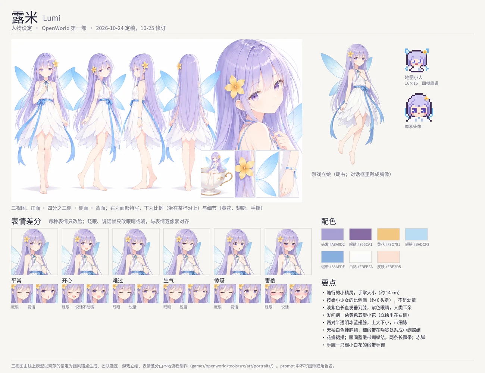

# Lumi (露米): character sheet

Status: **her own portrait built (2026-10-24)**. What is already in the game is marked *(canon)* and cited; the rest is
proposed. The art direction, the tools and the file formats are [../character-art.md](../character-art.md); Nessa's sheet
([nessa.md](nessa.md)) is the model this one follows, and Nessa's turnaround is the style every later design is drawn to.

## 1. Who she is

| | |
|---|---|
| Name | Lumi · 露米 *(canon: the companion `pip`, `content/src/quests/main.ts` alias; named from lumen, she was Pip until 2026-10-12)* |
| What | a fairy who goes where the player goes, from the waking on Cloudtop to the end *(canon: docs/prologue.md)*: follows, flies, tells the tracked quest (E on her opens her panel), says the story's beats in a bubble over her head |
| Size | as tall as a hand (about 14 cm); drawn with the proportions of a petite young woman, about six heads tall, never a child |
| Temperament | bright, curious, brave, has something to say about everything *(canon: her lines)*; the sadness is the player's to find, never hers to say *(canon: lore.md, wiki 露米 §设定)* |
| What she does not know | she is what is left of the **second vessel** *(canon: lore.md)*: someone who tried to bear the Five Sufferings after Astra and could not; they took her power and her memory and left a small fairy who does not know what she was. The seals' power flows to her when a bearer falls, "like water finding an old riverbed"; she thinks it a gift |

**In one line:** the light at the player's side in the lengthening night — and the one thing in Part One older than she looks.

## 2. Her design

The team's reference is the fairy of *Symphonic Rain* (Phorni: hand-sized, gentle, a visual novel's companion) — for us only;
no prompt names her, a work or an artist. Unlike her, Lumi is seen by everyone.

- **Hair** long, straight, lavender, falling to her knees, a few strands floating.
- **The flower** a yellow five-petal flower pinned in her hair: five petals for the Five Sufferings (a hint no one reads yet). It
  glows when a seal's power finds her *(canon: the star it replaces glowed, `tools/src/art/fairy.ts`)*. The turnaround pins it on her
  left; her portrait, turned to face right, wears it on her right (the turnaround's own views disagree on the side).
- **Eyes** violet; **ears** human, never pointed.
- **Wings** two pairs, translucent ice blue, finely veined, the upper pair larger.
- **Dress** a white sleeveless halter dress, its thin blue ribbon tied at her throat in a small bow with two short tails, its skirt in
  layered petal-shaped panels that flare a little like a candle flame; a blue satin sash tied in a bow with two long trailing tails; bare
  feet. (2026-10-25: the sheet also ran a ribbon from the neck straight down the bodice to the sash, which read as one ribbon with it;
  it is taken out of the turnaround, the design book and the portrait.)
- **The bracelet** a thin blue ribbon round her wrist with a small white flower. Proposed: it hides a ring of faint, thin, healed
  marks (the second vessel's), which no one in Part One sees.

Palette (sampled from her portrait): hair `#A8A0D2`, eyes `#866CA1`, flower `#F3C781`, wings `#BADCF3`, ribbon `#88AEDF`,
dress `#FBFBFA`, skin `#FBE2D5`.

## 3. Her own portrait (2026-10-24, built)

- **The sheet** by the user's online model from the brief below, Nessa's turnaround uploaded as picture 1 "a style reference only";
  it matched Nessa's line, colour and face, where the local models (Qwen-Image-Edit given Nessa's sheet, NetaYume v4 from words)
  drew generic faces and elf ears. The sheet is kept with the drafts, outside the repository.
- **The sprite** drawn locally by Qwen-Image-Edit from the sheet: the whole figure floating, three-quarter, a hand resting at her
  chest (a first round waving was left: a wave does not fit a sad or a frightened face, and the pose stays under every mood). Drawn
  facing left; the cut turns her to face right like Nessa (`mirror`).
- **The set** `games/openworld/tools/src/art/portraits/lumi.json` → `public/assets/lsw/Portraits/lumi/`: six moods, each with its
  blink and talk; the mouth's region measured on the turned sprite, small enough to leave the jaw's line alone (a larger one left a
  ghost of the jaw in a talking frame); the neck ribbon, below the face, edited once and laid into every frame alike. Her happy face
  has no talk frame: it already laughs open-mouthed, and keeps its mouth while she speaks (`moodFrames`). Her angry face is narrowed,
  sulky eyes and a small turned-down pout, only the eyes and the mouth redrawn (`moodFeatures`, a hard edge): asked to frown, the
  model drew a second pair of brows over her faint ones under the bangs (read as four eyebrows), so her brows stay the neutral's; a
  second pass clears the old lid's ghost above the lashes (`moodTouch`), its blink is the neutral's shut eyes, its talk a small
  parting of the pout (earlier rounds: puffed cheeks bent her jaw, then the lips were thick). The bust is framed so her head is in the
  middle of what the dialogue box shows, the wings beside it cut by the box.
- **In the game** the catalogue's `portraits.pip`: her lines in scenes and when she is spoken to show it; the beats in her bubble have
  no portrait. Her companion panel shows the wider picture of each mood (`panel: true`, `<mood>-panel.webp`) with her own wings, in
  place of her look's portrait (`COMPANION_LOOK`, a different drawing that predates the design).
- **The map sprite** (`tools/src/art/fairy.ts`) recoloured to the design: lavender hair, the flower with an orange heart where the
  star was, ice-blue wings without the pink, the blue ribbon at her collar.

## 4. Open

- More moods: frightened and shivering (by the waystone of the Five Wounds: "it's cold near it" *(canon: her line)*), thinking,
  sleepy. The engine's `Mood` has six; a seventh is an engine change, for later.
- Her moments as CGs: Nessa's third (the Cloudtop log, "a sleeping light in the snow") waits on her design, now there
  (nessa.md §5).
- `COMPANION_LOOK` (`content/src/looks.ts`) is left only as the panel's fallback when the catalogue has no set for her; it could be
  dropped, or made to follow the design.

## 5. The brief (for the online model)

Each prompt begins with the style anchor; picture 1 is Nessa's turnaround, picture 2 (for the second and third) the chosen sheet.

**Style anchor.** Picture 1 is the art-style reference for this game's characters. Draw a new, different character so that she clearly
belongs to the same game and the same artist as picture 1. Match exactly: the very thin, light, coloured line art (soft brown-grey
lines, no thick black outlines); the pale, low-contrast, matte colouring with gentle cel shading and soft airbrushed gradients; hair drawn
as many fine separate strands with subtle highlights; the face and eye drawing — a small oval face, elongated, slightly heavy-lidded eyes
that are not oversized, irises with soft layered gradients and small highlights, fine lashes, a nose shown as a small shadow, a small
mouth; the calm, refined mood; the plain white background. Do not copy the woman in picture 1: not her black hair, glasses, feather
ornament, coat, clothes or colours.

**1. The turnaround.** A character design reference sheet on a plain white background, landscape 16:9, with no text or labels: the
same fairy drawn at the same scale four times, full body from head to feet, floating upright with her arms relaxed: a front view, a
three-quarter view, a side view in profile, and a back view showing her wings. To the right, a large close-up of her face and
shoulders. Below it, a small drawing of her sitting on the rim of a teacup to show how small she is, and a small drawing of the yellow
flower. Even, neutral light, no cast shadows. — Lumi, a tiny fairy only as tall as a hand (about fourteen centimetres), drawn with the
slender proportions of a petite young woman about six heads tall, not a child. Long, soft, pale lavender-silver hair falling to her
knees, a few strands floating; a small yellow five-petal flower tucked over her right ear. Large clear violet eyes (but drawn the way
picture 1 draws eyes), a bright, curious smile, fair skin with a faint blush. Ordinary rounded human ears, not pointed, not elf ears.
Two pairs of translucent ice-blue wings like frost on a window, finely veined, glittering faintly at the edges. A simple sleeveless
white dress to her knees, its hem cut in soft layered petal-shaped panels that flare a little like a candle flame (white fabric, no
fire, no yellow); a thin pale-blue ribbon at the waist; bare feet. Around her left wrist, a ring of very faint, thin, healed pale
marks. A soft light around her.

**2. The expressions.** Picture 2 is this fairy's design sheet: keep her exactly as drawn there. An expression sheet on a plain white
background with no text or numbers: her head and shoulders twelve times in a grid of four columns and three rows, every one in the
same three-quarter view, size and framing, changing only the expression: neutral; happy, laughing; sad; pouting, cross; surprised;
shy, blushing, looking aside; thinking, a finger at her chin; sleepy; a soft smile with closed eyes; scared and shivering, hugging
herself; the neutral face with the eyes closed; the neutral face with the mouth slightly open.

**3. The sprite.** Picture 2 is this fairy's design sheet: keep her exactly as drawn there. A visual novel character sprite on a plain
white background, portrait 2:3, no text: her whole figure from head to bare feet, floating in a relaxed three-quarter view, her face
toward the viewer, her wings spread behind her; even, soft front light, no cast shadow, crisp clean edges for cutting out.

If it comes out too sweet: *Not moe, not chibi: her eyes as narrow and calm as in picture 1, her face drawn the same way as the woman's
in picture 1.*
