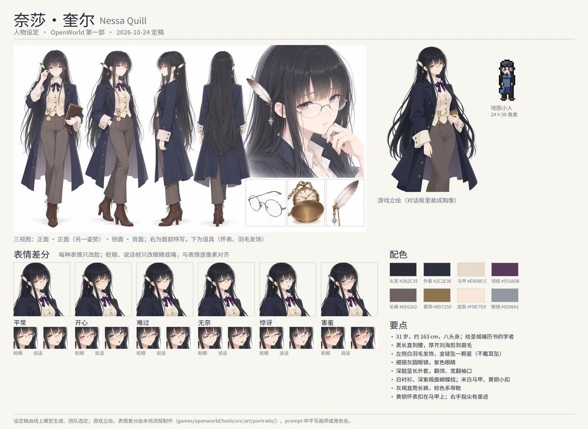
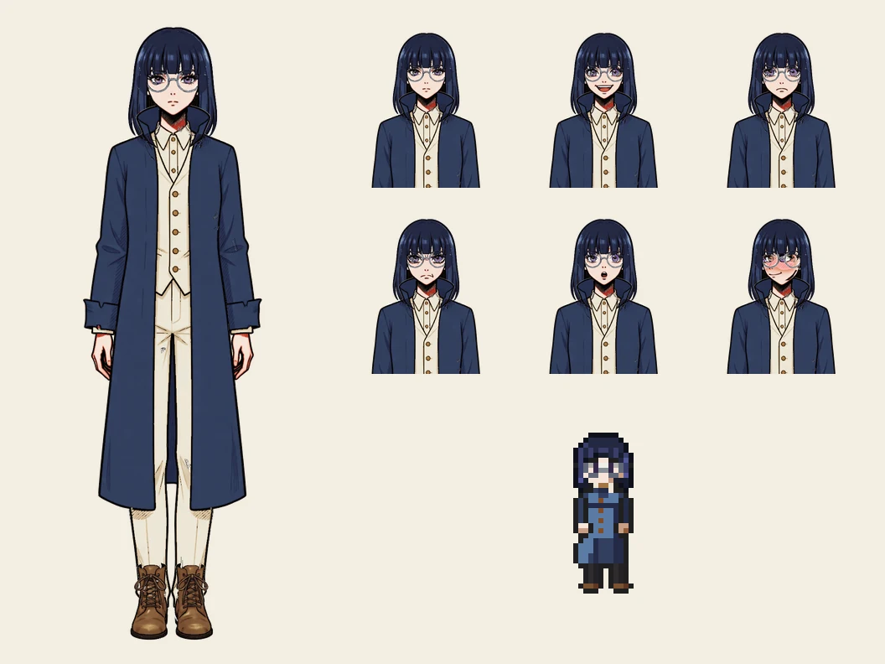

# Nessa Quill (奈莎·奎尔): character sheet

Status: **proposal (2026-10-24) for the team; her CGs in progress** (character-art.md §4b; the shot book
`games/openworld/tools/src/art/cg/shots/nessa.json`). What is already in the game is marked *(canon)* and
cited; the rest is proposed. The art direction, the tools and the file formats are [../character-art.md](../character-art.md).

## 1. Who she is

| | |
|---|---|
| Name | Nessa Quill · 奈莎·奎尔 *(canon: `tools/src/demo/people/nessa.ts`)* |
| Age | 31 *(canon)*; drawn as an adult in her late twenties |
| Work | makes the almanacs of the Holy City: she measures the sky — sunsets, sunrises, the stars — for the Church's printed tables *(canon)* |
| Where | stranded in Firstlight since the footbridge went *(canon)*. She sleeps under the market shelter (no room was free); copies her tables at her desk by the square from 6 to 17; from 17 to 23 she is at the village's east end, timing the sunset *(canon: her schedule; anchors `nessa.desk` 27,16 and `nessa.watch` 34,17 on `meadow`)* |
| Temperament | restless, polite, outgoing, wary *(canon)*; quick and sleepless *(canon: chapter-1.md §7)* |
| What she wants | to cross the river and measure the far horizon, lower than this one *(canon: chapter-1.md §7)* |
| What she does not say | the old almanac's last pages, written as the First Night fell, beg someone to "stop him", and she cannot place it *(canon)*. Proposed: she has sent three reports to the Holy City since the bridge went, and none was answered — as the Cloudtop watchman's eleven years of reports were not |
| Her favourite gift | a candle *(canon: `content/src/gifts.ts`, by her id)*: she works on after dark |
| She sells | a map, scrolls, ink, a quill *(canon)* |

**In one line:** the one person in Part One who sees the Long Night coming in numbers, not omens — and who keeps
saying it means nothing.

### Her place in the story

- She is the **first layer's witness** (lore.md §7–8): the days are shortening, measurably; her curve matches an
  almanac from before the First Night "exactly" *(canon: her lines)*. She believes the numbers and is wary of what the
  Church prints, but she does not doubt Astra — Part One never does.
- The almanac's last line, "He says he will take it all. Whoever reads this — stop him." *(canon: `content/src/items.ts`
  `item/document/almanac`)*, is lore.md §9's first misreading planted: in truth it is Astra taking the Night into
  himself (§10). She reads "him" as a monster, as Severin does. Her CGs keep to that reading.
- Her errand *The Watchman's Log* touches Lumi's mystery: the log speaks of "a sleeping light in the snow" on
  Cloudtop, where the player wakes beside Lumi *(canon: `quests/side.ts` `watch`, its `done` line)*.

### People round her (proposed ties)

- **Tobin**, the peddler: sold her the old almanac and still argues the price.
- **Sister Ilse**: lights the chapel's lamps a little earlier every week "and writes it down" *(canon: Ilse's line)*.
  Two women keeping the same record, one by faith and one by measure; each has read the other's book. A quiet respect.
- **Pell**: copies her star charts into his drawings; she pretends not to have noticed the corrections he makes.
- **Lumi**: Nessa wants to know whether a fairy counts as a light source for her readings. Lumi is flattered.

## 2. How she looks

**Her own portrait (2026-10-24, built):** the design the user chose (very long straight black hair, blunt bangs, the white feather
ornament with its gold chain and star pendant — no earrings, they were taken off so the two stars do not repeat — round silver-grey
glasses, the indigo coat with lapels and wide turned-back cuffs, a white shirt, a deep violet satin bow, a cream waistcoat with brass
buttons, taupe straight trousers, the brown laced boots as drawn); its sheet is the design book above (the master
`nessa-design-book.png` and the turnaround without earrings are kept with the drafts, outside the repository); palette hair `#2B2C35`,
coat `#2C2E3E`, waistcoat `#E9DBCC`, ribbon `#553A5B`, trousers `#6E6262`, brass `#8D7250`; in the game `lsw/Portraits/nessa/` (neutral, happy, sad, angry, surprised, shy, each with its blink and talk), her regions
for the pipeline `games/openworld/tools/src/art/portraits/nessa.json`; her look record `hair.long` with black hair (the map sprite's coat keeps its own colours: the trousers and the feather are below what 24x36 shows). The text below is the earlier record.

**Redesign under way (2026-10-24, the user's decision):** the key characters get special portraits of their own, drawn in the
manner of a visual novel's official character design; Nessa's hair becomes very long, straight and black (blunt bangs,
side locks), the rest of her design kept. The design sheets (a turnaround, an expression sheet, the sprite) are being
made with an online model from a brief (its prompts and file specs: the brief artifact); once one is chosen it becomes her
anchor, her look record (`nessa.ts`) follows it (`hair.long`), and the CGs are drawn again from it. What follows describes
her current look portrait.

### The anchor: her portrait in the game *(canon)*

The looks system draws her from her look record (`nessa.ts` pins `hair.bob`, `face.keen`, `glasses.round`,
`outfit.coat`; the rest comes from her id: `legs.hose`, `shoes.boots`; colours raven, violet, porcelain, iron,
indigo, undyed, leather). Made again, every mood at full size (768×1536), the bust and the sprite, by
`npx tsx games/openworld/tools/src/art/looks/person.ts npc.nessa <dir>`.

**Every picture of her keeps to it**: the same hair, glasses, clothes and colours. The dialogue keeps this portrait; a CG
draws the same design in its own clean line and atmosphere (character-art.md §2). The proposals below only add small
things to it.

| Part | Design |
|---|---|
| Build | slender, about 163 cm; stands a little forward, as if about to go somewhere *(proposed)* |
| Hair | straight blue-black (deep navy) bob to the shoulders, heavy blunt bangs to the brows *(canon)*; **a quill pushed into her hair behind the right ear**, where her lost pens turn up *(proposed)* |
| Eyes | violet *(canon)*; a little heavy-lidded from too little sleep, sharp when she measures *(proposed)* |
| Glasses | thin round silver-grey (iron) rims *(canon)*; **pushed up onto her head when she looks at the sky**, an expression of its own *(proposed)* |
| Coat | open indigo long coat to the knees, a high stand-up collar, wide turned-back cuffs *(canon)* |
| Under it | cream collared shirt, cream waistcoat with a row of small brass buttons, cream trousers, laced brown leather ankle boots *(canon)* |
| Her instrument | **a brass pocket chronometer** on a chain clipped to her waistcoat — the Church's issue, five small wounds engraved on its lid; she times every sunset on it *(proposed)* |
| Small things | ink stains on the fingers of her right hand; a single star-shaped glass earring on her left ear (the errand's reward, the *Star-glass Earring*, is its twin); a leather satchel of rolled star charts when she goes out *(proposed)* |
| Silhouette | the bangs and the bob, the round glasses, the long dark coat open over pale cream: she reads at a glance, small or large |

**Palette** (sampled from the portrait; the ink is proposed)

| | Hex |
|---|---|
| hair | `#242944`, lit `#3A4670` |
| eyes | `#8463AA` |
| skin | `#F6E0D3` |
| coat | `#323F5E` |
| shirt, waistcoat, trousers | `#EAE2D0` |
| brass (buttons, chronometer) | `#A47139` |
| glasses | `#9298A1` |
| boots | `#6F472C` |
| ink | `#1E2340` |

## 3. How she speaks

- Fast, precise, in numbers: "Do you know what time it is? Exactly, I mean. To the minute." *(canon)*. Counts under her breath.
- Dry, and funny without trying: "I have four pens and I lose them in the same order every week. There is a pattern.
  I have not found it." *(canon)*
- Says the frightening thing and takes it back: "I am sure it means nothing." *(canon)*
- Habits for the portraits and the scenes: taps the chronometer's lid; pushes her glasses up with a knuckle; chews the
  end of the quill; counts on her fingers.
- Chinese: short sentences, numbers as digits in her tables but words in speech, 「精确地」, a 「嘘——」 before she counts.

## 4. The expressions

The engine's six moods, which her look portrait already has (§2, the busts); the table says what each face is for, and
how a CG of her should read in it. Her `shy` face is the look system's `face.keen` one, broken (its eyes redrawn larger
and turned aside, so the glasses and bangs no longer sit on them; a hard band of blush over the lower lids): to be drawn
again by the portrait pipeline, which needs that face's original pictures from its work dir (docs/looks.md §4).

| Mood | Her face | When she has it |
|---|---|---|
| neutral | attentive, the corner of the mouth just up; glasses on | most lines |
| happy | eyes narrowed in a real smile, mouth open; chronometer raised | "There." — a reading taken; a candle given |
| sad | eyes lowered, lips pressed; the glasses slipped a little | the curve; the unanswered reports |
| angry | exasperated rather than angry: brows knit, the quill pointed | rounding, "it is only weather" |
| surprised | eyes wide behind the glasses, the glasses askew | the statues' note; the light in the snow |
| shy | looking aside, pushing her glasses up, a faint blush | thanked; caught counting aloud |
| *(extra, later)* skyward | glasses up on her head, chin raised, eyes on the sky | at her watch, measuring |

## 5. Her moments (event CGs)

All four lie in Part One (release 1), on triggers the story already has (`StepCond`). Lines are drafts; *(canon)*
marks lines already in the game. Each CG is a 16:9 frame whose lower 30% the dialogue box covers.

### 5.1 「数到十五」 · Counting to Fifteen — the first sunset

- **Trigger:** the first time the player stands near her watch at sunset: `{ map: 'meadow', spot: { x: 34, y: 17, r: 3 },
  hour: { from: 17, to: 19 }, weather: ['sun', 'cloud'] }`.
- **Scene:**
  1. `picture: lsw/CG/nessa/01-sunset.webp`
  2. Nessa: "Hush — the sun is touching the trees. Fourteen. Fifteen. There." / 「嘘——太阳碰到树梢了。十四。十五。好了。」 *(canon)*
  3. Nessa *(happy)*: "Seventeen forty-one. Last month it was seventeen forty-five." / 「十七点四十一分。上个月还是十七点四十五。」 (her curve: four, five, six minutes a month, *canon*)
  4. Nessa *(shy)*: "You were counting with me. I could hear you." / 「你刚才跟着我一起数了。我听见了。」
  5. Lumi *(happy)*: "I counted too! I got to twelve." / 「我也数了！我数到了十二。」
  6. Nessa: "Twelve is a fine number. It is just not the right one." / 「十二是个好数字。只是不对。」
  7. `picture: null`
- **The CG** (the shot book's `01-sunset`): a medium close-up from the waist up, at eye level, tilted about ten degrees.
  She takes most of the frame's height on the right, her face at the upper right third, turned left in three-quarter
  profile toward the sun; the pocket watch held up at eye level. The wind in her hair; a blurred fence post in front, on
  the left; Firstlight's roofs and the chapel spire small and out of focus, low on the left. No protagonist.
- **Light and colour:** the sun low behind her on the left: a gold rim on her hair, cheek, glasses and coat; her front in
  the sky's pink-violet; a sky from amber through rose to violet; dust motes.

### 5.2 「最后几页」 · The Last Pages — after *The Measure of Days*

- **Trigger:** the errand handed in: `{ map: 'meadow', quest: { measure: { gte: 100 } }, hour: { from: 18, to: 23 } }`.
- **Scene:**
  1. `picture: lsw/CG/nessa/02-almanac.webp`
  2. Nessa: "Lower every week, and faster than the old almanac says." / 「一个礼拜比一个礼拜低，比旧历书上算的还快。」 *(canon, the hand-in)*
  3. Nessa *(sad)*: "Look at the last page. The hand changes. He pressed so hard the pen went through." / 「看最后一页。字迹变了。他用力到笔尖把纸划破了。」
  4. Nessa: "'He says he will take it all. Whoever reads this — stop him.'" / 「『他说他会把一切都担下来。读到这里的人——阻止他。』」 *(canon: the almanac's text)*
  5. Nessa *(angry)*: "Who is he? What was there to stop? I measure the sky. I do not know how to measure that." / 「他是谁？要阻止什么？我量的是天。这个我不知道该怎么量。」
  6. Lumi: "Do you want me to hold still? I'm brighter than the candle." / 「要我别动吗？我比蜡烛亮。」
  7. Nessa *(shy)*: "...You are. Thank you." / 「……确实。谢谢。」
  8. `picture: null`
- **The CG** (`02-candle`): a medium shot from about fifteen degrees above, a small tilt. She takes about two thirds of
  the frame's height, centre right, leaning over the old almanac, her fingertip on the last line of the hurried hand,
  torn where the pen went through; the open book sharp in the lower left foreground, the candle left of centre, a cup of
  tea, stacked tables; the canvas roof's edge and the village's warm windows out of focus behind.
- **Light and colour:** the candle is the key, from the front and below, its flame in her glasses; a cool night blue rims
  her hair from behind; Lumi a small glow in the blurred right foreground; shadows blue, never black; uneasy, not afraid.

### 5.3 「雪里睡着的光」 · A Light Asleep in the Snow — after *The Watchman's Log*

- **Trigger:** the errand handed in: `{ map: 'meadow', quest: { watch: { gte: 100 } } }`.
- **Needs Lumi's design first** (character-art.md; docs/looks.md §7 lists her as "not yet").
- **Scene:**
  1. `picture: lsw/CG/nessa/03-log.webp`
  2. Nessa *(surprised)*: "Eleven years. The sunsets were coming early eleven years ago, and he wrote it down every night, and nobody read it." / 「十一年。十一年前日落就开始提前了，他每天晚上都记下来，可是没有人读过。」 *(canon)*
  3. Nessa: "...A sleeping light in the snow. I do not know what he meant by that. I am sure it means nothing." / 「……雪里有一点睡着的光。我不明白他写的是什么意思。应该没什么吧。」 *(canon)*
  4. Lumi *(shy)*: "I remember snow. And being very, very sleepy." / 「我记得雪。还有好困、好困。」
  5. Nessa *(sad)*: "Then we have that in common." / 「那我们倒是有这一点一样。」
  6. Nessa: "I will write him down. Someone should read him." / 「我会把他记下来。总该有人读一读。」
  7. `picture: null`
- **The CG:** dusk at her watch. She holds the watchman's logbook — swollen with snow-damp, the ink run in places —
  open against her chest, and looks at Lumi, who hovers at her eye level, puzzled, glowing softly. Nessa's face gentle,
  worried for her, a little afraid of what the log might mean. The first CG with Lumi in it.
- **Light and colour:** cold blue dusk, the snow-white of the log's pages, Lumi's warm light the only warm thing.

### 5.4 「星星不在乎」 · The Stars Do Not Care — a clear night (optional)

- **Trigger:** both errands done, a clear night at her watch: `{ map: 'meadow', spot: { x: 34, y: 17, r: 3 }, hour: { from:
  20, to: 23 }, weather: ['sun'], quest: { measure: { gte: 100 }, watch: { gte: 100 } } }`.
- **Scene:**
  1. `picture: lsw/CG/nessa/04-stars.webp`
  2. Nessa: "The stars do not care what the Church prints about them. That is rather restful, after a day of almanacs." / 「星星不在乎教会印了它们什么。编了一天历书之后，这一点倒挺让人歇心。」 *(canon)*
  3. Nessa *(happy)*: "Lie down. You see more lying down. That one is the Ferryman — Hesper would like that." / 「躺下来。躺着看得更多。那一组叫『摆渡人』——赫斯珀会喜欢的。」
  4. Nessa: "When the bridge is mended I am going across. The horizon is lower over there. A whole extra minute of sky." / 「等桥修好了，我要过河去。那边的地平线更低。能多看一整分钟的天。」
  5. Nessa *(shy)*: "You could hold the chronometer. If you are going that way anyway." / 「你可以帮我拿着怀表。反正你也要往那边走。」
  6. `picture: null`
- **The CG** (`04-stars`): from straight above, the frame on a diagonal. She lies on a blanket in the grass, her hair
  spread round her head, her glasses pushed up onto it; her head at the upper left third, her raised arm reaching to the
  upper right, pointing at the stars, the folded star chart on her chest; she fills the frame from corner to corner; the
  candle lantern (the gift) in the lower left; grass and small white flowers blurred in the corners; fireflies.
- **Light and colour:** cool starlight from above as the key, the lantern's warm orange on her cheek and hand; restful.
- **A hook, not a promise:** her wish to cross is canon; whether she travels in Part Two is the team's to decide.

## 6. Prompts

Her CGs' words — each shot's drawing words, the identity pass's words, the camera, framing and light they come from, and
the references studied for them — are the shot book, `games/openworld/tools/src/art/cg/shots/nessa.json`, which `cg.py`
reads (character-art.md §4b). The two blocks below are her in words, for any model or artist outside that pipeline.

**Natural language:**

> Nessa, an adult woman of thirty-one who looks in her late twenties, slender, about 163 cm. Straight blue-black (deep
> navy) hair in a bob that reaches her shoulders, with heavy blunt bangs to her eyebrows; a quill pen pushed into her
> hair behind the right ear. Violet eyes, a little tired. Thin round silver-grey wire-rimmed glasses. Fair porcelain
> skin. An open indigo long coat reaching her knees, with a high stand-up collar and wide turned-back cuffs; under it a
> cream collared shirt and a cream waistcoat with a row of small brass buttons; cream trousers; laced brown leather
> ankle boots. A brass pocket chronometer on a chain clipped to her waistcoat. A single small star-shaped glass earring
> on her left ear. Ink stains on the fingers of her right hand.

**Tags:**

> 1girl, solo, adult, mature female, slender, dark blue hair, blue-black hair, straight hair, bob cut, medium hair,
> blunt bangs, quill behind ear, purple eyes, round eyewear, thin-framed eyewear, grey-framed eyewear, glasses, pale
> skin, indigo coat, long coat, open coat, high collar, turned-back cuffs, white shirt, collared shirt, waistcoat,
> buttons, white pants, brown boots, lace-up boots, ankle boots, pocket watch, watch chain, single earring, star
> earring, ink stains

The shots as drawn so far (2026-10-24), each to its spec in the book:

| Shot | Camera · framing · light | Picked |
|---|---|---|
| 5.1 Counting to Fifteen | eye level, tilted ~10° · waist up, her face at the upper right third, turned left to the sun · the low sun behind her: a gold rim; a pink-violet fill from the sky | seeds 5, 6 |
| 5.2 The Last Pages | ~15° from above · two thirds of the height, centre right; the almanac sharp in front, the candle left of centre · the candle from the front and below; a cool rim from the night; Lumi's glow in front | seeds 11, 12 |
| 5.3 A Light Asleep in the Snow | waits for Lumi's design | — |
| 5.4 The Stars Do Not Care | straight above, on a diagonal · corner to corner, her head upper left, her arm to the upper right · starlight from above; the lantern's warm light from the lower left | seeds 14, 13, 12 |

## 7. To do

1. The team reads this sheet; the looks (the pins in `nessa.ts`) follow the design once it is chosen.
2. Her CGs: the picks above through the detail pass into `lsw/CG/nessa/`; 5.3 once Lumi has a design.
3. The four scenes as story steps (`games/openworld/tools/src/demo/quest/chapter1.ts`), each a requirement in the demo
   test, with the CGs; placeholders until the art comes.
4. Her wiki page (人物/奈莎·奎尔): the portrait and her moments.
