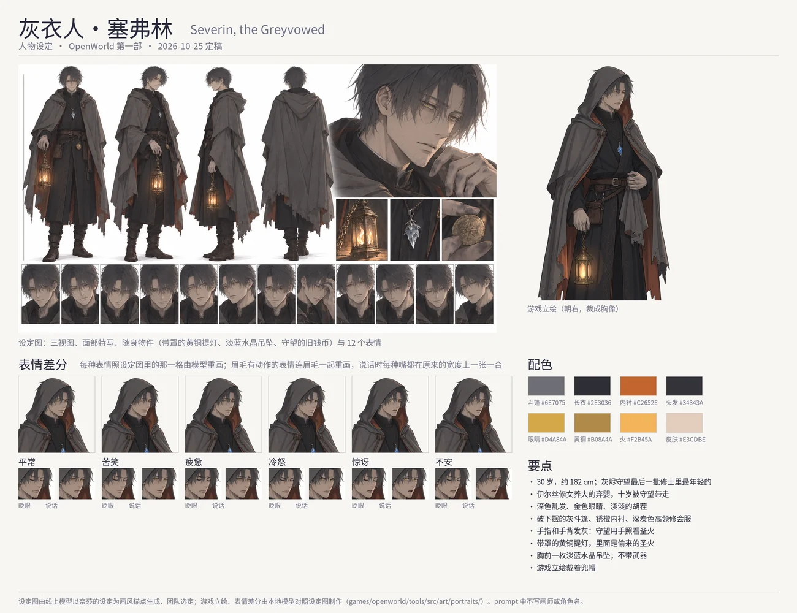

# Severin, the Greyvowed (灰誓者·塞弗林): character sheet

Status: **built (2026-10-25)**: he has a portrait of his own, after the online model's sheet (`game_pic/new/`) and his canon (§2b). What is in the game is marked *(canon)* and cited. The art direction, the tools and the file formats are
[../character-art.md](../character-art.md); Nessa's turnaround is the style every sheet is drawn to ([nessa.md](nessa.md)); the first
man of the cast, so the brief says a man's face and build in words.

## 1. Who he is

| | |
|---|---|
| Name | Severin · 塞弗林, "the grey man" in the game *(canon: `tools/src/demo/people/severin.ts`, `npc.severin`; chapter-1.md §5)* |
| Age | 30 (lowered from about 40 on 2026-10-25, with Ilse's 56 → 46) |
| What he was | the youngest brother of the Ashen Watch, the order that kept the flames lit from the first dawn, dissolved ten years ago and named heretic *(canon)* |
| Temperament | grim, plain, reserved, wary *(canon)* |
| His rule | never harms anyone, never explains more than a sentence; every act of his also protects someone; the player never fights him *(canon)* |
| In one line | a tired, steady man who carries what he believes is the world's last chance in a brass lantern, and never says more than he must |

### What the story gives him *(canon)*

- A foundling left on the step of Firstlight's chapel; Ilse, a novice of sixteen, raised him; the Watch took him at ten (the boy at the
  bridge-payer's heel, Joss's line). He looks back once at Ilse's window on the night of the flame.
- He believes Astra is the First Night itself and the pilgrimage would wake him; he takes the Firstlight to hold what each fallen seal
  lets go. In Part One he is seen: ash on the shrine stone, the door shut on the restless warden and the bread marked with the Watch's
  ash thumbprint, the flame taken from the chapel ("...Not tonight."), the river frozen with the frost charm Tobin sold him.
- In Part Two he warns the pilgrim on the East Road and takes what the Crown lets go; he looks at Lumi a moment too long.

### Proposed for his look

- *(Proposed in the brief, not taken: his hair gone ash-grey the year the Watch was burned; the sheet drew it dark and that was kept.)*
- **His hands are dark with ash**: the Watch tended its flames by hand, and the ash never washes out of the skin.
- **The lantern**, a small hooded brass lantern on a short chain *(canon: chapter-1.md §5)*, is the only warm colour on him: the
  stolen Firstlight in it.

## 2. His design

- **Build** lean and tall, about 182 cm; a quiet, watchful stillness.
- **Hair** dark, near black (the sheet drew it so, and it sets off the gold eyes; the brief had ash-grey), short and unkempt, a few
  strands over his brow.
- **Eyes** pale gold, the same warm gold as his lantern's flame (the user's choice, 2026-10-25; his look record has grey), tired and steady
  under level brows; a faint stubble *(canon: `beard.stubble`)*.
- **Clothes** a long grey travelling cloak, worn and frayed at the hem, its deep hood up but pushed back enough to show his face in
  soft shadow; under it the dark charcoal tunic and high collar of an old order, a narrow ember-orange lining at the cloak's edge; a
  worn leather belt with a pouch and the small pale-blue frost charm; dark trousers, travel-worn boots. No weapon.
- **His things** the hooded brass lantern with a warm golden flame; the frost charm; an old coin with no king's head (the Watch's).
- **In the game** his own portrait faces right, the hood up, the lantern held low at his side, the other hand holding the cloak closed;
  his map sprite keeps `hat.hood`, `outfit.cloak` in charcoal and slate, the hair dark, the eyes gold.

Palette (proposed): cloak `#6E7075`, tunic `#2E3036`, lining `#C2652E`, hair `#A3A5AC`, eyes `#D4A84A`, ash on the hands `#55565C`,
brass `#B08A4A`, flame `#F2B45A`, frost charm `#CFE6F2`, skin `#EBD3C3`.

## 2b. His own portrait (2026-10-25, built)

- **The sprite** seed 4 of eight drawn by Qwen-Image-Edit from his sheet, cut at mid-thigh (drawn whole, his face was too small for the
  dialogue's bust), the hood up (the user's choice; the sheet has it down), the lantern low at his side.
- **The moods** after the sheet's twelve faces (`moodRefs`): happy its rueful half smile (cell 3), sad (2), angry the cold stare (4),
  surprised (5), shy looking aside uneasy (6); sad, angry and surprised redraw the brows too (`brows`, `moodKeepAlso`).
- **The frames** the sad and surprised blinks drawn over a larger region with words for one clean lid line; the parted mouths of the
  surprised and uneasy faces open wider to talk, after the sheet's speaking face (cell 12); the smile talks along its own width.
- **In the box** framed like the women's: the bust lifted so his face sits as high in the dialogue box as theirs (his head is drawn larger).
- Config `tools/src/art/portraits/severin.json`; the set in `public/assets/lsw/Portraits/severin/`, the catalogue's `portraits['npc.severin']`;
  his look record follows: `hair.short` black, gold eyes (`#d4a84a`), the hood and the cloak in charcoal and slate.

## 3. His lines

Unchanged for now: one in Part One ("...Not tonight."), his warning and the Crown's in Part Two, two chat lines. To be looked at once
his design is settled.

## 4. The brief

As for the women: Nessa's turnaround as picture 1 for the style only, the words saying an adult man's face and build; the sheet, the
expression sheet and the sprite. Twelve expressions: stern and calm; a faint rueful half smile; weary sorrow; cold anger; restrained
surprise; looking aside, uneasy; resolved; tired; worried, glancing aside; quiet and almost gentle; a blink; a word. The full prompts
are on the brief page.
