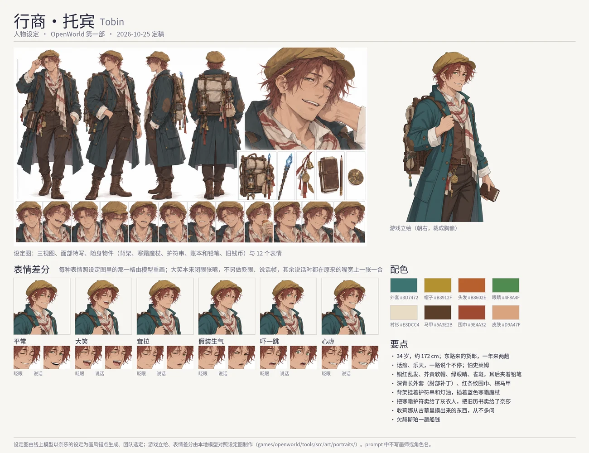

# Tobin (托宾): character sheet

Status: **built (2026-10-25)**: he has a portrait of his own, after the online model's sheet (`game_pic/new/`) and his canon (§2b). What is in the game is marked *(canon)* and cited. The art direction, the tools and the file formats are
[../character-art.md](../character-art.md); Nessa's turnaround is the style every sheet is drawn to ([nessa.md](nessa.md)).

## 1. Who he is

| | |
|---|---|
| Name | Tobin · 托宾, the peddler of the eastern road *(canon: `tools/src/demo/people/tobin.ts`, `npc.tobin`)* |
| Age | 34 *(canon)* |
| Work | brings charms, oils and oddments from the east twice a year; the storm stopped the ferry, so he moved his cart from the Ford to Firstlight *(canon)* |
| Temperament | chatty, polite, outgoing, hopeful *(canon)* |
| In one line | a cheerful storyteller of a merchant who talks the whole way, half of whose stories are true, and who is afraid of slimes |

### What the story gives him *(canon)*

- He has more lines than any other man in Part One (21): three places he is from, one of them right; a story for every charm, some
  true; the whole cart for a hot meal ("well, most of it"); never under a tree in a storm ("my uncle — well").
- He owes Hesper last autumn's fare and hopes she has forgotten (she has not).
- He trades the frost wand for bread at the Ford (the Ford's way across). He sold the grey man a frost charm last winter, paid in old
  coin with no king on it, and kept one for luck; when the flame is stolen he works out how the grey man crossed the river.
- He bought the old almanac Nessa treasures, and buys what Lina brings up from the barrows, never asking ([lina.md](lina.md)).

## 2. His design

- **Build** sturdy, about 172 cm, a little round in the face; always about to talk.
- **Hair** tousled copper-red under a soft mustard-yellow cap with a short brim (the user, 2026-10-25: red, not his record's chestnut,
  which Lina's brown hair is too close to) *(canon: `hair.messy`, `hat.cap` mustard)*.
- **Face** green eyes (his record's amber is Lina's, and Severin's are gold) with laugh lines at their corners, an easy grin; warm,
  sun-browned skin, a dusting of freckles; clean-shaven *(canon: `face.bright`, warm)*.
- **Clothes** a deep teal travelling coat to the knee (his record's russet would be red on red under the red hair), many pockets, patched
  elbows, worn open over a cream shirt and a brown waistcoat; a cream scarf with rust-red stripes knotted loosely; a broad belt with a
  coin purse, a small ledger and charms on cords; brown trousers, sturdy boots *(canon: `outfit.travel`)*; a pencil behind his ear.
- **His things** a wooden pack frame of wares on his back, no higher than his shoulders (rolled cloth, small bottles of oil, bundles of
  charms with tiny bells and ribbons, the slim blue frost wand); the ledger; the old coin kept for luck.
- **In the game** his own portrait faces right, one hand on his pack's strap, the other holding his ledger at his side; his map sprite
  follows: copper hair, green eyes, the coat in teal.

Palette (proposed): coat `#3D7472`, cap `#B3912F`, hair `#B8602E`, eyes `#4F8A4F`, shirt `#E8DCC4`, waistcoat `#5A3E2B`, scarf stripes
`#9E4A32`, leather `#7A5638`, frost wand `#7FB2D9`, skin `#D9A47F`.

## 2b. His own portrait (2026-10-25, built)

- **The sprite** seed 4 of eight drawn by Qwen-Image-Edit from his sheet, cut at mid-thigh, a hand on his pack's strap, the ledger
  in the other.
- **The moods** after the sheet's twelve faces (`moodRefs`): happy the laugh (cell 2), sad (3), angry mock indignation (4), surprised
  startled (5), shy the sheepish grimace (6); the laugh's mouth region reaches further than the grin's (cut by a smaller one, it lost
  its upper lip); every mood but the laugh redraws his thick brows (`brows`, `moodKeepAlso`).
- **The frames** every blink drawn over a larger region with words for one clean lid line (the first let the open eye show through),
  cut shorter below where it carried a faint pink; the grin and the grimace talk across their own width (the first turned the grin
  into a small round mouth); the laugh has no blink and no talk.
- **In the box** framed like the women's: the bust lifted so his face sits as high in the dialogue box as theirs (his head is drawn larger).
- Config `tools/src/art/portraits/tobin.json`; the set in `public/assets/lsw/Portraits/tobin/`, the catalogue's `portraits['npc.tobin']`;
  his look record follows: `hair.messy` copper, `leaf` (green) eyes, `outfit.travel` teal, the cap mustard.

## 3. His lines

Unchanged: they already have his voice. To be looked at once his design is settled.

## 4. The brief

As for the women: Nessa's turnaround as picture 1 for the style only, the words saying an adult man's face and build; the sheet, the
expression sheet and the sprite. Twelve expressions: a friendly grin; laughing; hangdog sorrow; mock indignation; startled; a
sheepish guilty grin; scared (a slime!); a salesman's wink; hungry; telling a tall tale; a blink; a word. The full prompts are on the
brief page.
