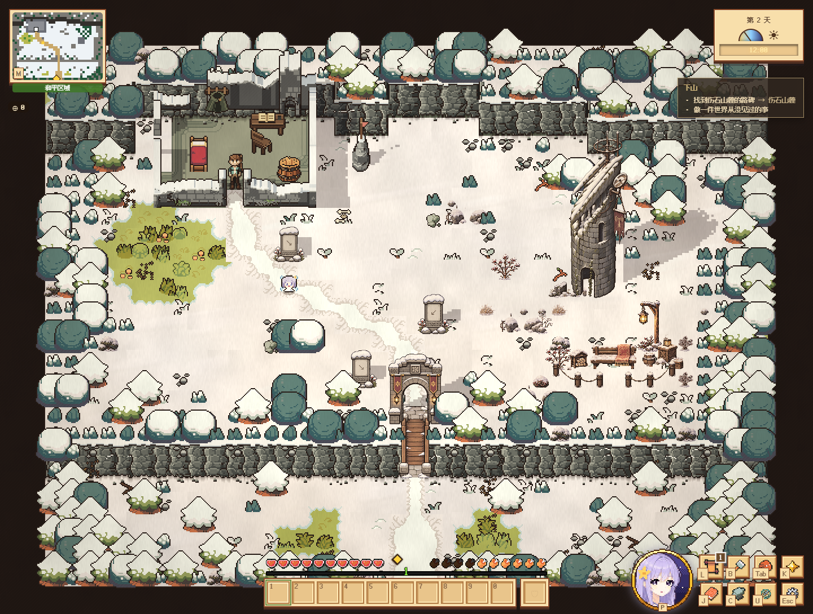
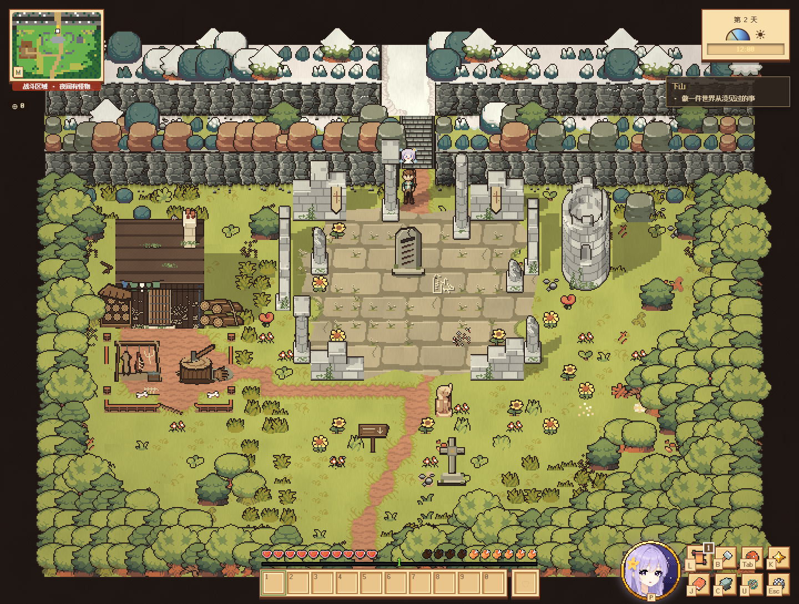
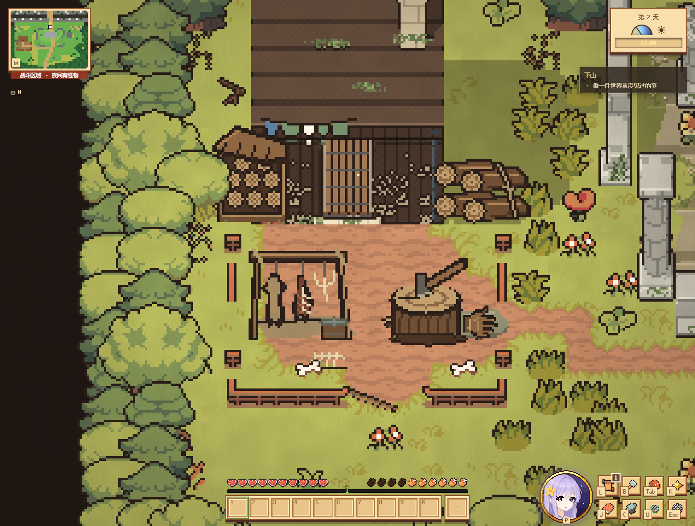
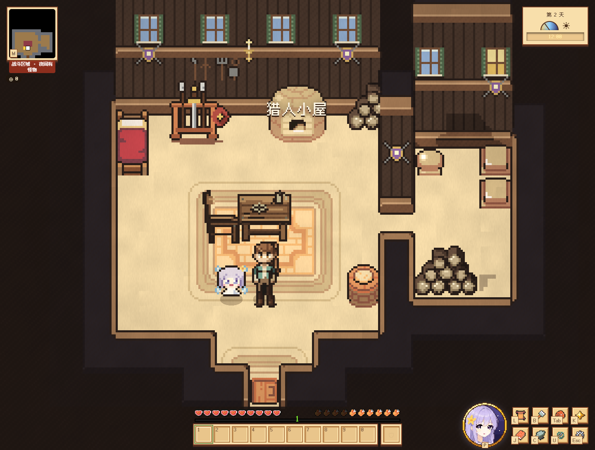
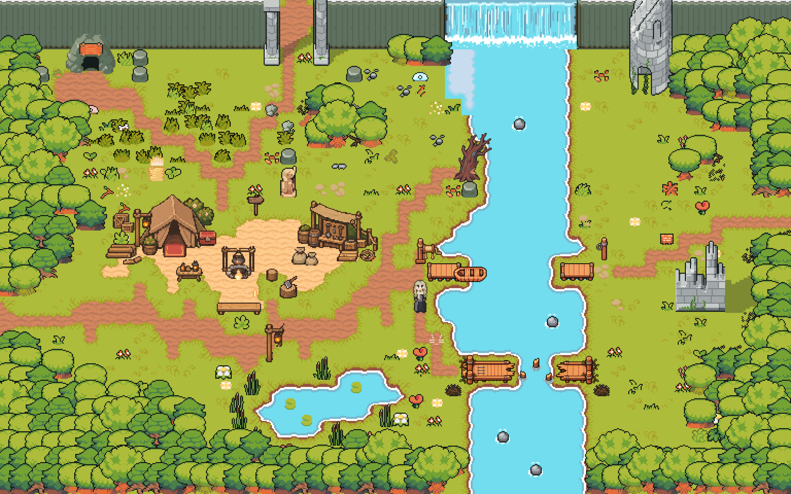
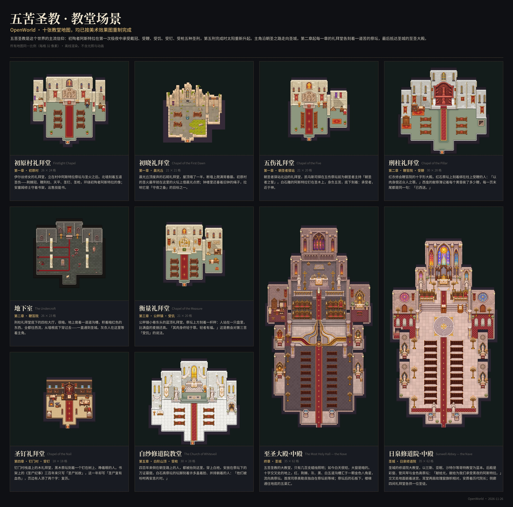

# Cloudtop and Woundstone Foot: art review draft

This draft freezes the current visual direction for maintainer feedback before further map work. It is not a request to merge before CI and gameplay review.

## Review focus

- Cloudtop: native round/triangular tree silhouettes, courtyard supplies, rope fences, shelter furniture and cloak hooks; imported snowy waymarks, arch and bridge; night lantern lighting.
- Woundstone Foot: connected worn courtyard paving, broad five-wound stone with a black first wound, preserved readable chalk clue, broken walls/columns and east tower.
- Hunter's yard and interior: timber storage, hunting rack, chopping area, readable glove pickup on its stone, locally drawn worn table and smaller chair.
- The current Cloudtop snapshot also enables the map-scoped snow surface (snowSurfaceMaps includes summit), with snow/straw edge treatment. This renderer remains in the current playable version despite an earlier request to roll it back; maintainer review should decide whether to retain, disable or split it.
- Supporting runtime/editor changes provide per-entity looks, pixel density for imported prefabs, furniture pose alignment and mounted-light layering. Cloak handling includes old-save compatibility.

## Screenshots

Captured in local playtest at noon, sunny weather. Overview zoom is 2; close views use zoom 5. These are actual game screenshots.

Rendered offline from the map files (no lighting or animation), as the wiki draws maps:

- Vesper Ford, the whole map: the north cliff and falls, the ferrykeeper's camp, the crossing (winch, piers, boat, far post), the broken footbridge, the dead tree and the pond. Rendered 2026-11-24, before the ferry went back to one way; the map looks the same.
- The churches: the ten chapel and church maps redone from the user's sheets, at one scale (32 px a cell), on one poster.

## Reproduce

Run npm install, npm run gen:world, then npm run dev. Open the client with ?lang=zh&modder=off&playtest=1&at=summit,10,7 or ?lang=zh&modder=off&playtest=1&at=foot,20,8. The hunter interior is foot.hut,6,13.

## Verification and limits

- npm run typecheck passed on Windows.
- npm run gen:world passed.
- Focused demo regression: three Cloudtop barrel/cloak/save tests passed.
- Actual browser captures and independent scene/configuration reviews completed.
- Full Linux/Windows/macOS creator checks, merge-gate, broad gameplay and older-save visual review remain for CI/maintainer review. No model calls are needed to play these maps.
- Imported PNG art was supplied during the scene-design iteration. Maintainers should confirm its provenance and redistribution suitability before merge.

## Feedback requested

Confirm the two maps' visual direction, imported/native asset consistency, prop scale and density, and whether the supporting presentation changes are acceptable. Keep this PR as a draft until these decisions and required checks are complete.
